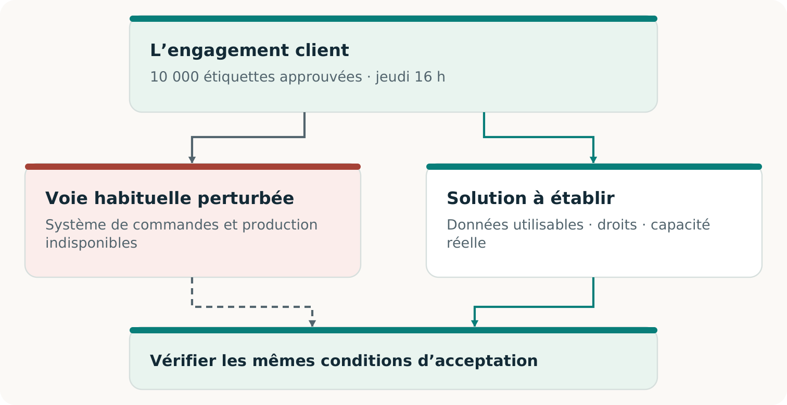
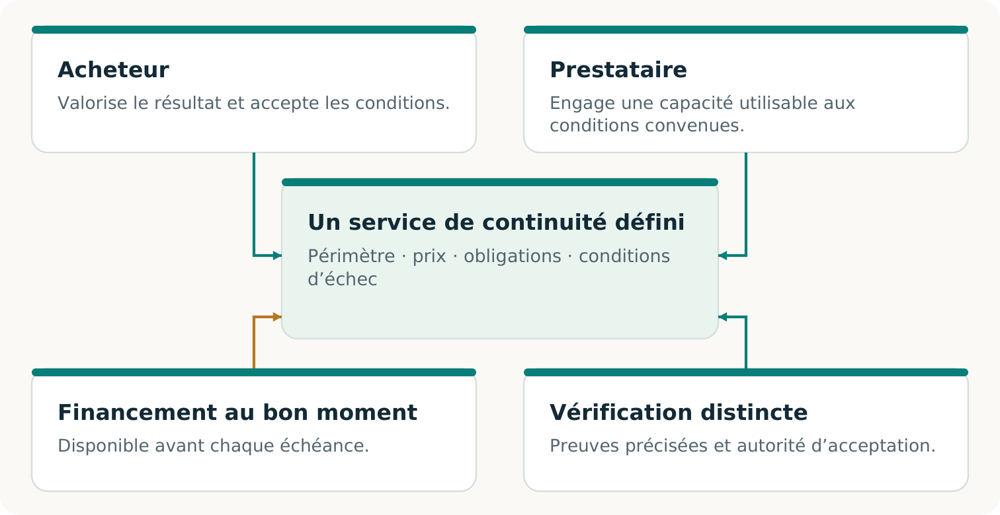

# CONTINUITÉ Ω

## Tenir parole

Une introduction claire à CONTINUITÉ Ω

Edition 2 · 7 novembre 2026

## Lorsque la voie habituelle ne fonctionne plus

**Les systèmes peuvent être à l’arrêt. Le client a toujours besoin de ce qui lui a été promis.**

CONTINUITÉ Ω est un projet pour aider une entreprise à préserver un engagement client essentiel lorsque son fonctionnement habituel échoue. Il cherche ce qui manque, aide à construire une solution réalisable et rend les preuves du résultat vérifiables. [C2, pp. 5–9]

> **L’idée centrale**
> L’entreprise peut changer sa façon de livrer. Elle ne peut pas modifier discrètement ce qu’elle a promis au client.

Un système de commandes restauré peut paraître sain tout en omettant la dernière modification approuvée. Un fournisseur de relève peut avoir une machine disponible sans disposer des bons fichiers, des matières ou du créneau nécessaire. La continuité dépend de toute la chaîne qui relie la commande acceptée au résultat accepté.

### Trouver ce qui manque

Repérer le dossier, la dépendance ou l’entente qui empêche de tenir l’engagement.

### Construire une voie utilisable

Réunir l’information, les capacités et les participants volontaires nécessaires à la livraison.

### Étayer la conclusion

Vérifier le résultat selon l’entente initiale et conserver les éléments probants. [C2, pp. 9–14]

L’ambition plus large est de rendre une continuité utile économiquement possible pour des entreprises qui ne peuvent justifier le dédoublement de toutes leurs opérations, puis de conserver chaque capacité éprouvée pour d’autres travaux. [C2, pp. 18–23]

## L’imprimeur doit toujours livrer les étiquettes

**Cas pédagogique fictif.** Un imprimeur régional a promis 10 000 étiquettes d’emballage approuvées, avec le visuel v3, à livrer au lieu convenu au plus tard jeudi à 16 h, dans le fuseau convenu. Un incident bloque son processus habituel. Attendre la restauration complète pourrait compromettre la livraison. Un imprimeur de relève qualifié pourrait aider si toute la solution fonctionne. [C2, pp. 5, 7–9]

La relève exige la commande et le visuel à jour, la permission de les utiliser, une production compatible, un créneau réellement disponible et une livraison à temps. Le transfert doit aussi éviter une production en double au retour du système initial. [C2, pp. 11–14]

> **Ce qui peut changer**
> Le prestataire, le chemin de l’information, le procédé et l’arrangement qui les soutient. La quantité, la qualité, le délai et les critères d’acceptation convenus font toujours autorité.

## Rendre la relève intéressante à fournir

Un imprimeur disposant d’équipements libres et un acheteur inquiet d’une interruption n’ont pas automatiquement un service utilisable. Il faut préparer le travail, réserver une capacité exploitable, vérifier la prestation et financer chaque étape. [C2, pp. 18–20]

CONTINUITÉ Ω explore ensemble la voie technique et cet arrangement. Un dossier de production transférable peut rendre un créneau réservé utile; une réservation acceptée peut justifier la préparation du dossier. Aucun des deux ne suffit nécessairement seul.

> **Le test économique**
> Les participants choisiraient-ils cet arrangement complet plutôt que leurs solutions de rechange crédibles, et peuvent-ils l’exécuter?

Mutualiser la préparation peut réduire le coût. La capacité doit encore couvrir les activations simultanées, et les fonds être disponibles à temps. Les achats réels et la réutilisation constituent des preuves distinctes. [C2, pp. 19–20; F2, p. 3]

## Savoir à quoi accorder sa confiance

### L’engagement a-t-il été tenu?

Le travail respecte la quantité, la qualité, le délai et les critères d’acceptation convenus. Un résultat logiciel accepté étaye un résultat logiciel; une livraison physique exige sa propre observation.

### L’arrangement fonctionne-t-il?

Consentement, droits, capacité, incitations et financement s’articulent. Un modèle teste des hypothèses fournies; une préparation réelle exige des preuves concernant les participants réels.

### Existe-t-il un marché viable?

Des parties réelles choisissent l’offre, une valeur acceptée est livrée, le paiement est encaissé et les coûts complets sont comptés. D’autres adoptions ou renouvellements étayent la répétabilité. [C2, pp. 8, 14, 18–22; F2, p. 3]

« Vérifiée de manière indépendante » devrait préciser qui a vérifié, quelles pièces ont été examinées et comment le contrôle était séparé de la production du résultat. Une seconde IA ou un programme distinct peut révéler des erreurs; les liens et hypothèses communes restants doivent demeurer visibles. [C2, pp. 6, 14, 24–25]

> **Une première décision utile**
> Choisir un engagement client dont la perte aurait des conséquences. Comparer des solutions complètes et compétentes. Mettre à l’épreuve celle qui mérite d’être étudiée, puis décider de la suite selon le résultat observé.

### Poursuivre la lecture

Le **volume 02** développe l’histoire et les idées. Le **volume 03** prépare un pilote délimité, et le **volume 04** aide à consigner les décisions. Le **volume 05** présente l’examen daté des preuves : recherche, exécutions logicielles et affirmations exigeant encore un appui réel.

## Sources

- C2: CONTINUITÉ Ω. 03_Original_Papers/C2_CONTINUITE_OMEGA_Recherche_FR.pdf
- F2: Invent the Economy. 03_Original_Papers/F2_Invent_the_Economy.pdf
