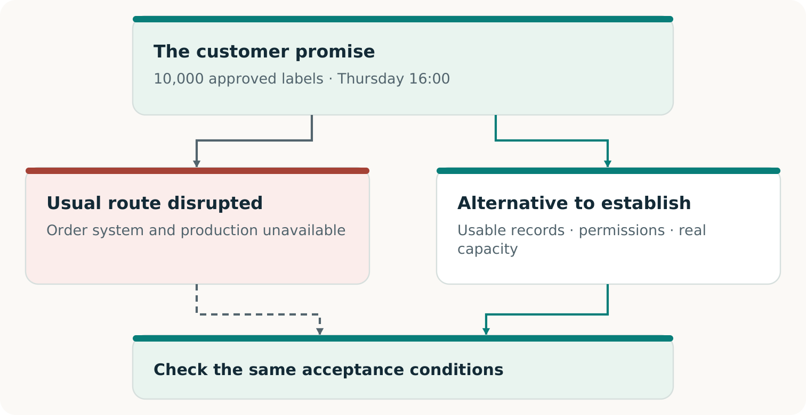
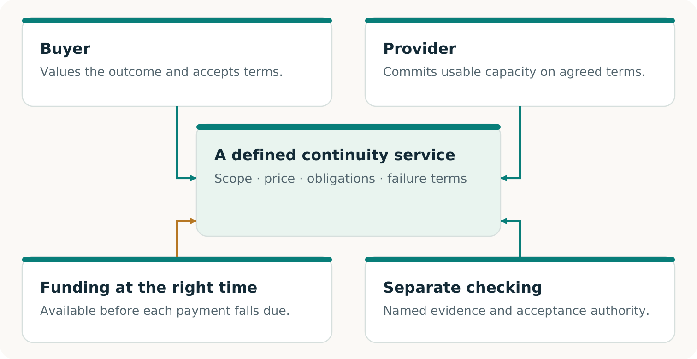

# CONTINUITY Ω

## Keep the promise

A clear introduction to CONTINUITY Ω

Edition 2 · 7 November 2026

## When the usual way stops working

**The systems may be down. The customer still needs what was promised.**

CONTINUITY Ω is a project to help a business preserve an essential customer commitment when its usual way of working fails. It looks for what is missing, helps construct a workable alternative and makes the evidence for the result inspectable. [C1, pp. 5–8]

> **The central idea**
> The business may change how it delivers. It cannot quietly change what the customer was promised.

A restored order system can look healthy while missing the latest approved change. A backup supplier can have an available machine but lack the right files, materials or production slot. Continuity depends on the whole path from the accepted order to the accepted result.

### Find the missing part

Expose the record, dependency or agreement that prevents the promise from being kept.

### Build a usable way through

Connect the information, capabilities and willing participants needed to deliver.

### Earn the conclusion

Check the result against the original agreement and preserve the evidence. [C1, pp. 9–13]

The larger ambition is to make useful continuity economically possible for businesses that cannot justify duplicating all their operations—and to retain each proven capability for future work. [C1, pp. 17–21]

## The printer still owes the labels

**Invented teaching case.** A regional printer has promised 10,000 approved packaging labels using artwork v3, due at the agreed location by Thursday 16:00 in the agreed time zone. A cyber incident disables its usual workflow. Waiting for complete restoration may miss delivery. A qualified alternative printer could help if the complete route works. [C1, pp. 5, 7–8]

The alternative needs the current order and artwork, permission to use them, compatible production, a genuinely available slot and timely delivery. A successful handoff must also prevent duplicate production when the original system returns. [C1, pp. 11–13]

> **What can change**
> The provider, information path, production method and supporting arrangement. The agreed quantity, quality, deadline and acceptance conditions stay authoritative.

## Make the fallback worth providing

A printer with spare equipment and a buyer worried about disruption do not automatically have a service they can use. Someone must prepare the work, reserve usable capacity, verify performance and fund each stage. [C1, pp. 17–19]

CONTINUITY Ω explores the technical route and this arrangement together. A portable production package can make a reserved slot useful; an accepted reservation can make the package worth preparing. Neither may solve the problem alone.

> **The economic test**
> Would the participants choose this complete arrangement over their credible alternatives—and can they carry it out?

Shared preparation may reduce cost. Capacity must still cover the promises that can activate together, and money must be available when needed. Real purchases and repeat use are separate evidence. [C1, pp. 18–19; F2, p. 3]

## Know what deserves confidence

### Was the promise kept?

The specified work met the agreed quantity, quality, deadline and acceptance conditions. An accepted software output supports a software result; physical delivery requires its own observation.

### Does the arrangement work?

The necessary consent, rights, capacity, incentives and funding fit together. A model can test supplied assumptions; real readiness requires evidence about the actual participants.

### Is there a viable market?

Real parties choose the offer, accepted value is delivered, payment is collected and complete costs are counted. Additional adoption or renewal supports repeatability. [C1, pp. 8, 13, 17–20; F2, p. 3]

“Independently verified” should tell you who checked, what they inspected and how their check was separated from producing the result. A second AI or a separately written program can help find errors; the relationship and remaining shared assumptions must stay visible. [C1, pp. 6, 13, 22–23]

> **A useful first decision**
> Choose one customer promise that would matter to lose. Compare complete, capable routes. Rehearse the one worth investigating and let the observed result determine the next step.

### Where to go next

Read **Volume 02** for the story and ideas. Use **Volume 03** to prepare a bounded pilot and **Volume 04** to record decisions. Consult **Volume 05** for the dated evidence review: the research, executed software work and claims that still need real-world support.

## Sources

- C1: CONTINUITY Ω. 03_Original_Papers/C1_CONTINUITY_OMEGA_Research_EN.pdf
- F2: Invent the Economy. 03_Original_Papers/F2_Invent_the_Economy.pdf
