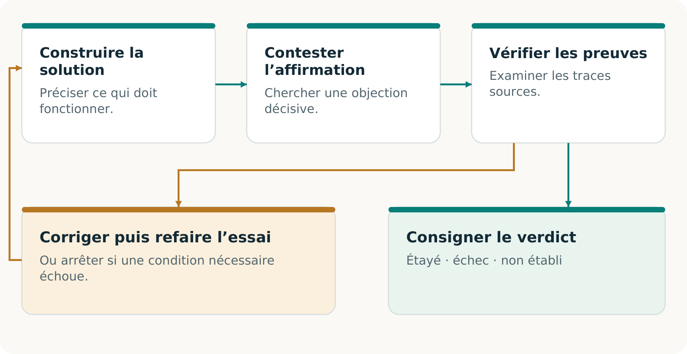
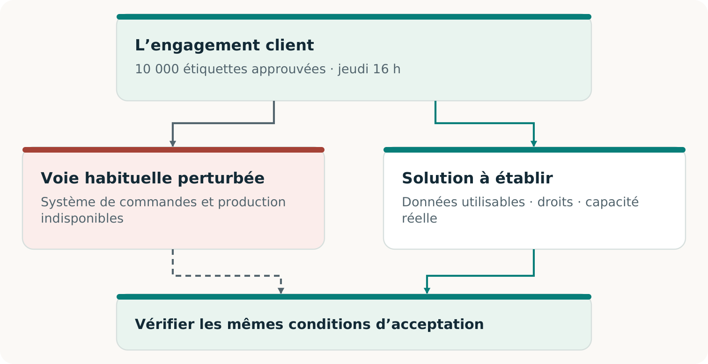
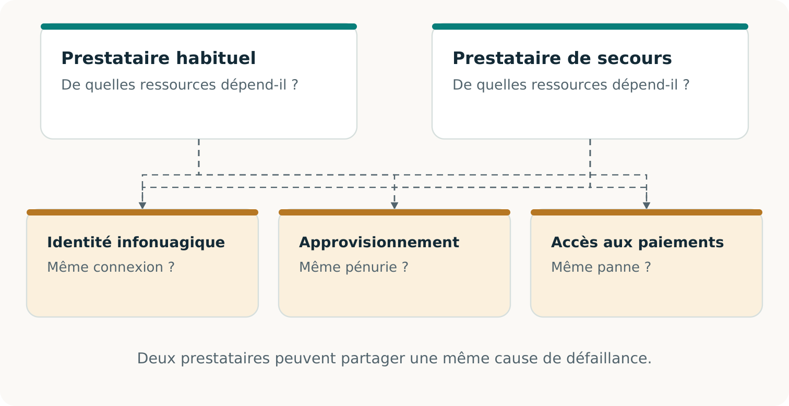
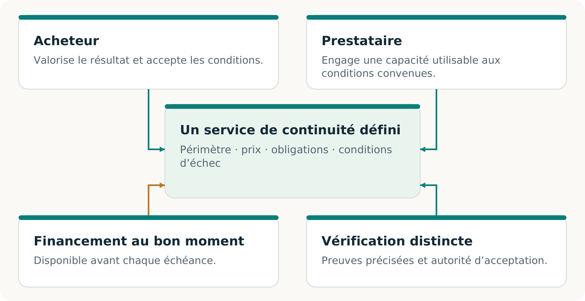
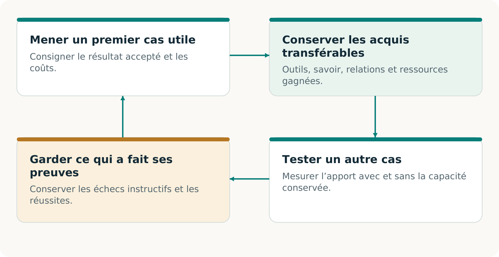

# CONTINUITÉ Ω

## L’histoire et la méthode

De la commande interrompue à une solution de livraison viable

Edition 2 · 7 novembre 2026

## Partir de ce que la défaillance change pour le client

Un client qui attend une livraison a besoin des bons produits à temps. Le redémarrage d’un serveur compte parce qu’il peut contribuer à ce résultat. Il ne permet pas, à lui seul, de savoir si la commande est correcte, si les produits peuvent être fabriqués ou si le client les recevra.

**CONTINUITÉ Ω est un projet pour aider une entreprise à tenir un engagement client précis lorsque sa voie habituelle est perturbée.** Il étudie ce dont dépend cet engagement, aide à construire les moyens manquants et vérifie si l’arrangement obtenu peut livrer le résultat convenu. [C2, pp. 5–9]

> **Le point de référence**
> Ce client. Ce résultat. Cette qualité. Ce délai. Ces permissions. Ces critères d’acceptation.

Ce point de départ ouvre un espace d’invention. Une application indisponible pourrait être restaurée. Un dossier protégé pourrait permettre le travail sans elle. Un partenaire qualifié pourrait produire la commande pendant la reprise du site initial. Chaque option mérite le même contrôle du résultat.

### L’ambition plus large

La planification de la continuité utilise déjà des solutions de rechange, des exercices et des preuves de reprise. L’ambition de recherche consiste ici à intégrer leur découverte et leur construction à des arrangements commerciaux volontaires, puis à apprendre quelles capacités conservées améliorent d’autres travaux. Un service conventionnel compétent peut légitimement l’emporter. [C2, pp. 6, 18–23]

Les pages suivantes suivent une commande d’imprimerie fictive dans ce raisonnement. Elles expliquent l’opportunité et les preuves nécessaires pour la poursuivre. Les volumes pratiques transforment ensuite ce même cas en pilote et en documents de travail modifiables.

## Retrouver la commande acceptée par le client

**Ce cas suivi est inventé à des fins pédagogiques.** Ses quantités, horaires et montants ne sont ni des clients, ni des mesures, ni des prix réels rapportés. Le lieu et le fuseau horaire convenus font partie de l’engagement fictif.

### La commande acceptée

Livrer 10 000 étiquettes approuvées, avec le visuel v3, au plus tard jeudi à 16 h au lieu convenu.

### Le dossier restauré

Après l’incident, le carnet de commandes récupéré indique 8 000 étiquettes.

### La modification conservée

Un enregistrement authentifié, conservé hors de la vue restaurée, atteste une augmentation acceptée de 2 000 étiquettes.

Un processus vérifiant seulement l’ouverture de l’application pourrait manquer l’écart. Une comparaison attentive avec la modification conservée le révèle. Les 2 000 étiquettes manquantes appartiennent à la commande acceptée; elles ne sont pas une production supplémentaire facultative.

Voilà pourquoi l’origine des preuves compte. Si aucun enregistrement disponible ne distingue l’historique de 8 000 étiquettes de celui de 10 000, un autre examinateur ne peut déterminer lequel s’est produit. La solution peut être un accusé de réception protégé ou une meilleure conservation des dossiers. [C2, pp. 9–10]

> **Deux mesures du temps comptent**
> La reprise du service mesure quand l’application peut fonctionner de nouveau. L’échéance du client indique quand le résultat convenu doit être livré et accepté.

Un rapprochement ordinaire peut aussi trouver cette omission. CONTINUITÉ Ω doit démontrer sa valeur ajoutée par la solution complète qu’il aide à construire, le travail économisé ou le résultat rendu possible, en donnant à la méthode conventionnelle les mêmes preuves. [C2, pp. 21–22]

## Donner un rôle utile au second regard

Une IA peut proposer un plan; une autre peut rechercher les omissions importantes. Poser une question précise : **La commande récupérée conserve-t-elle chaque modification acceptée jusqu’à la limite convenue?** Ici, l’objection utile désigne l’ajout manquant de 2 000 étiquettes et son effet sur la livraison.

L’examinateur a besoin de la source, au-delà du résumé initial. Son objection précise une exigence importante, une défaillance plausible et un moyen de vérifier l’allégation. L’assurance d’un second modèle ne décide pas du résultat. [C2, pp. 5–6, 10–11]

> **Une critique constructive**
> Trouver la condition manquante, établir si elle compte, puis construire ce qu’exige le résultat accepté. Contester aussi une affirmation non étayée selon laquelle aucune autre voie ne serait réalisable.

## Changer les moyens en préservant l’entente

La question initiale pourrait être : « Comment redémarrer cette usine avant jeudi? » L’objectif autorisé du client peut permettre une question plus large : **« Comment livrer les étiquettes approuvées au plus tard jeudi à 16 h? »** [C2, p. 5; F1, pp. 2–3]

Le changement transformationnel consiste à examiner si une façon de travailler héritée limite inutilement le résultat. Construire un autre chemin d’information, procédé ou arrangement de coopération lorsqu’il améliore le résultat complet. Conserver la meilleure voie existante comme élément de comparaison.

> **Une limite réelle**
> Si l’entente exige une usine, une matière ou une approbation précise, cette exigence reste obligatoire. La modifier nécessite une nouvelle entente autorisée; cela ne peut rendre l’engagement initial rétroactivement conforme. [C2, pp. 8–11; F1, p. 3]

## Donner au prochain prestataire un dossier exploitable

L’imprimeur de relève ne peut travailler à partir de « Terminez notre commande urgente ». Il lui faut une information fiable et une autorité suffisantes pour produire le même résultat approuvé. Construire cette transmission exploitable constitue déjà une capacité. [C2, pp. 11–12]

### Décrire le travail

L’obligation actuelle de 10 000 étiquettes, le visuel v3, la matière et la qualité approuvées, les modalités de livraison et l’échéance.

### Autoriser le travail

Les droits d’utilisation nécessaires, les données dont le partage est permis, l’autorité de lancement et un moyen authentifié d’activer la voie convenue.

### Refermer la boucle

Des identifiants de commande stables, modifications, annulations et reçus qui évitent une production ou une facturation en double au retour des opérations habituelles.

La transférabilité préserve le sens. Une conversion de fichier réussit si le prochain prestataire reçoit la bonne spécification et peut l’utiliser dans les conditions convenues. Un bel aperçu ne remplace pas un fichier de production réellement utilisable par les équipements et les opérateurs.

### Un dossier restreint et suffisant

Transmettre l’information approuvée nécessaire par la voie permise. Copier tout l’environnement affecté peut accroître l’exposition sans aider la production. Versions actuelles, accès délimités et procédure de révocation joignable comptent, car un dossier auparavant valide peut devenir inadapté.

> **Une question d’acceptation concrète**
> Le prestataire pourrait-il expliquer exactement ce qu’il est autorisé à fabriquer, démontrer que son procédé le permet et retourner des preuves qui se rapprochent de la commande initiale?

Le cas passe ainsi d’un dossier corrigé à une voie opérationnelle possible. Il reste à déterminer si cette voie sera utilisable lors de la perturbation, quand d’autres clients en auront également besoin. [C2, pp. 11–14]

## Vérifier que la relève évite la défaillance réelle

Un second imprimeur peut dépendre du même accès défaillant, de la même matière ou du même transport. Un autre nom de fournisseur ne crée pas à lui seul une voie utilisable. Toute la solution doit résister à la perturbation revendiquée. [C2, pp. 11–12]

Dans notre cas fictif, le créneau de relève offre 12 000 unités exploitables. Des travaux antérieurs protégés en exigent 2 000. Il reste exactement 10 000 unités pour notre commande. Une autre demande simultanée de 5 000 ne tient pas sans modifier l’arrangement.

> **Une réservation a des conséquences**
> Elle engage une capacité limitée sous des conditions définies. Vérifier les engagements existants et la demande simultanée; maintenir la réservation quand la situation change. Un rapport de capacité libre n’est pas une réservation. [C2, pp. 13–14]

## Créer un arrangement que les participants choisissent

L’acheteur veut un résultat fiable; le prestataire, une rémunération pour la capacité et les obligations. Préparation, contrôle et livraison doivent être financés. CONTINUITÉ Ω explore ensemble la capacité et cet arrangement volontaire. [C2, pp. 18–20; F2, pp. 2–3]

**Montants fictifs en dollars canadiens : achat distinct du service de continuité par l’imprimeur principal, hors facture initiale du client final.** Un devis de 5 600 $ face à un coût complet estimé de 5 000 $ suggère une contribution projetée de 600 $. Mais 4 700 $ sont dus avant l’acceptation et seuls 1 200 $ sont disponibles : il manque 3 500 $.

> **La solution manquante peut être économique**
> Un calendrier de financement autorisé, une autre production ou une préparation moins coûteuse peuvent changer la faisabilité. Chaque changement exige preuves et comptabilisation des coûts. Une contribution projetée ne paie pas les dépenses antérieures. [C2, pp. 19–20]

## Distinguer une voie réalisable d’un marché démontré

Un bon service de continuité réunit un résultat accepté et un arrangement que les participants peuvent maintenir. Ces réalisations sont liées, mais répondent à des questions différentes. Les rendre visibles aide l’acheteur à savoir ce qu’il achète et le prestataire à savoir ce qu’il a gagné.

### Résultat

Le travail respecte-t-il les exigences initiales? Pour notre commande, il faudrait établir les étiquettes convenues, la quantité, la qualité, le délai et l’acceptation. Un exercice logiciel établit seulement le résultat logiciel effectivement mis à l’épreuve.

### Faisabilité du service

L’arrangement est-il exécutable dans ses conditions déclarées? Consentement, droits, capacité simultanée, incitations, coûts complets et calendrier de financement doivent s’articuler. Un modèle fourni établit un calcul conditionnel; une préparation réelle exige des preuves réelles.

### Preuve commerciale

Des participants réels acceptent-ils les modalités et reçoivent-ils la valeur promise? Consigner livraison acceptée, paiement encaissé, coûts complets de campagne et obligations restantes. D’autres adoptions ou renouvellements indépendants sont nécessaires pour étayer la répétabilité. [C2, pp. 8, 18–22; F2, p. 3]

Une nouvelle possibilité économique pourrait émerger ici. Une entreprise qui ne peut justifier une usine en double pourrait trouver une relève qualifiée et maintenue intéressante. Un prestataire pourrait aussi trouver intérêt à servir ces engagements. Leur arrangement préféré doit encore dépasser leurs solutions de rechange crédibles et rester réalisable lorsque les demandes arrivent ensemble.

> **Facturer l’étape réellement achetée**
> Un exercice de préparation payé établit l’achat de cette préparation. Il n’établit pas l’acceptation d’une offre ultérieure de réservation ou d’activation. Chaque étape a sa valeur livrée et ses preuves. [C2, pp. 8, 20]

Le volume 05 présente l’état daté des preuves existantes. Il distingue la recherche initiale, les travaux logiciels locaux ultérieurs et les observations supplémentaires nécessaires aux affirmations opérationnelles ou commerciales.

## Rendre le résultat facile à examiner et à utiliser

Le Passeport de continuité consigne l’engagement, l’exercice, les observations et les conditions de recontrôle. Il facilite la prochaine décision. [C2, pp. 14–15]

| Rubrique | Ce dont le lecteur a besoin |
| --- | --- |
| Engagement | Destinataire, résultat, quantité, qualité, échéance, permissions et autorité d’acceptation. |
| Exercice | Voie, entrées, versions, perturbation, dépendances, capacité simultanée, résultats et preuves manquantes. |
| Vérification | Garde des sources, vérificateur, méthode, lien au producteur et hypothèses de confiance. |
| État et validité | Modalités et état de la capacité; factures ou encaissements; coûts, obligations, expiration, révocation et motifs de nouvelle vérification. |
### Préciser l’indépendance

Une garde distincte des sources peut protéger la référence. Un contrôle programmé séparément peut révéler une erreur de code commune. Un évaluateur externe peut ajouter une séparation organisationnelle. Ces mesures répondent à des risques différents. Une autre IA ou un chemin de code dans le même projet ne fournissent pas automatiquement une assurance externe. [C2, pp. 6, 9–10, 14, 24–25]

> **Lire chaque verdict dans son périmètre**
> Démontré : les exigences annoncées ont été satisfaites dans l’exercice. Échec : une exigence applicable a été violée. Non établi : des preuves décisives manquent ou sortent du périmètre.

Le rapprochement peut être démontré sans établir la livraison physique. Un refus correct peut réussir un test de sûreté alors que l’engagement complet échoue. Une nouvelle vérification examine les preuves actuelles; un Passeport sauvegardé décrit le passé. [C2, pp. 14–15; R1; R3]

## Utiliser une capacité pour en rendre une autre possible

Les progrès de l’IA peuvent rendre de nouveaux outils praticables. Supposons qu’un exercice réel accepté produise un adaptateur, une méthode de contrôle et leurs conditions de validité. Un autre procédé pourrait bénéficier de cet héritage, ou révéler l’échec du transfert. [C2, p. 23]

ALPHA GENESIS FLYWHEEL Ω demande si la construction validée aujourd’hui améliore ce qui peut être construit ensuite. Trois gains exigent des preuves distinctes : des gains financent la poursuite; les moyens hérités aident une nouvelle tâche; une procédure de découverte améliorée réussit mieux sur de nouvelles campagnes. [F3, pp. 3, 8, 20]

> **Une prochaine opportunité possible**
> Des prestataires qualifiés pourraient offrir aux petites entreprises des créneaux de continuité maintenus et sans engagements incompatibles. C’est une hypothèse à construire et à tester, pas un marché établi par ce guide. [C2, p. 23]

## Choisir un engagement à préserver

Le point de départ est un engagement important, assorti d’une décision d’acceptation claire. Il est assez délimité pour être étudié de façon responsable et assez important pour que sa préservation compte. Le cas de l’imprimeur fournit un raisonnement; votre engagement réel fournit les exigences.

1. **Nommer le résultat.** Que doit recevoir qui, à quelle qualité, pour quand, et qui peut l’accepter? Inclure les pièces et permissions qui donnent autorité à ces modalités.

2. **Trouver l’obstacle réel.** Comparer les meilleures voies complètes disponibles. Déterminer si le blocage tient à l’information, à la compatibilité technique, à la capacité, au consentement, au financement ou à leur combinaison.

3. **Choisir une observation décisive.** Identifier le test qui pourrait modifier la décision. Convenir de son périmètre, de ses ressources et de ses conditions d’exécution sûres avant de le réaliser. [C2, pp. 21–22]

### Garder le choix ouvert

Utiliser un service existant s’il fournit le meilleur résultat complet. Construire une capacité manquante si sa valeur prospective justifie le travail. Arrêter ou réviser si les preuves ou l’économie ne soutiennent pas la prochaine étape. Une méthode utile doit reconnaître ces trois possibilités.

> **Ce qu’une réussite devrait laisser**
> Un résultat accepté, ou un obstacle clairement établi, avec des preuves qui facilitent la prochaine décision. Si une capacité est conservée, préciser où elle fonctionne, son coût et ce qui l’invaliderait.

### Poursuivre avec les volumes de travail

Le **volume 03** développe le pilote autour de la même commande fictive. Le **volume 04** fournit des fiches modifiables pour l’engagement réel, les participants, la capacité, les preuves et l’économie. Le **volume 05** indique les affirmations étayées à sa version de source et celles qui exigent d’autres observations.

L’ambition est concrète : rendre une activité importante possible grâce à un arrangement réalisable, démontrer sa valeur et conserver ce qui aidera à tenir un autre engagement. [C2, pp. 23–25]

## Sources

- C2: CONTINUITÉ Ω. 03_Original_Papers/C2_CONTINUITE_OMEGA_Recherche_FR.pdf
- F1: Transformational Intelligence. 03_Original_Papers/F1_Transformational_Intelligence.pdf
- F2: Invent the Economy. 03_Original_Papers/F2_Invent_the_Economy.pdf
- F3: ALPHA GENESIS FLYWHEEL Ω. 03_Original_Papers/F3_ALPHA_GENESIS_FLYWHEEL_OMEGA_v2.pdf
- R1: Présentation du dépôt. https://github.com/MontrealAI/CONTINUITY/blob/396227d8da2f55f674f479de16089c7ce28ef290/README.md
- R3: Résultats de qualification exécutée. https://github.com/MontrealAI/CONTINUITY/blob/396227d8da2f55f674f479de16089c7ce28ef290/docs/harness/RESULTS.md
