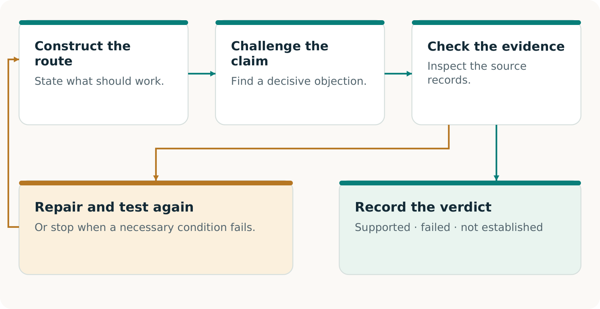
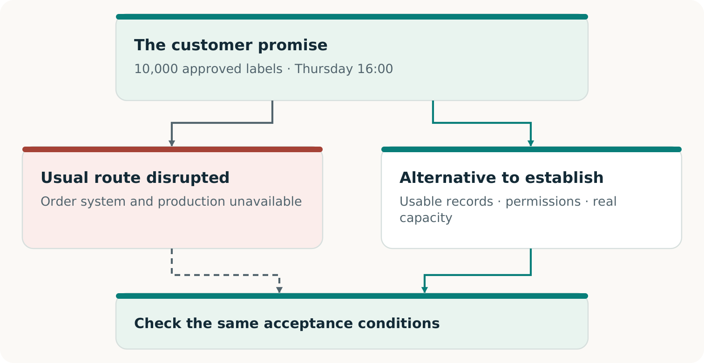
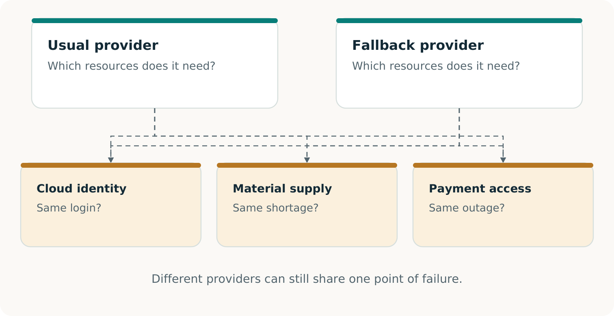
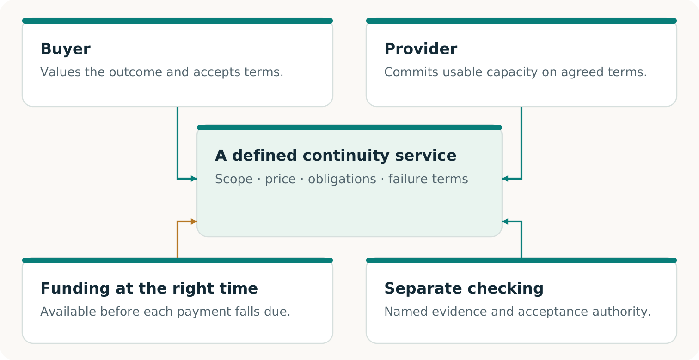
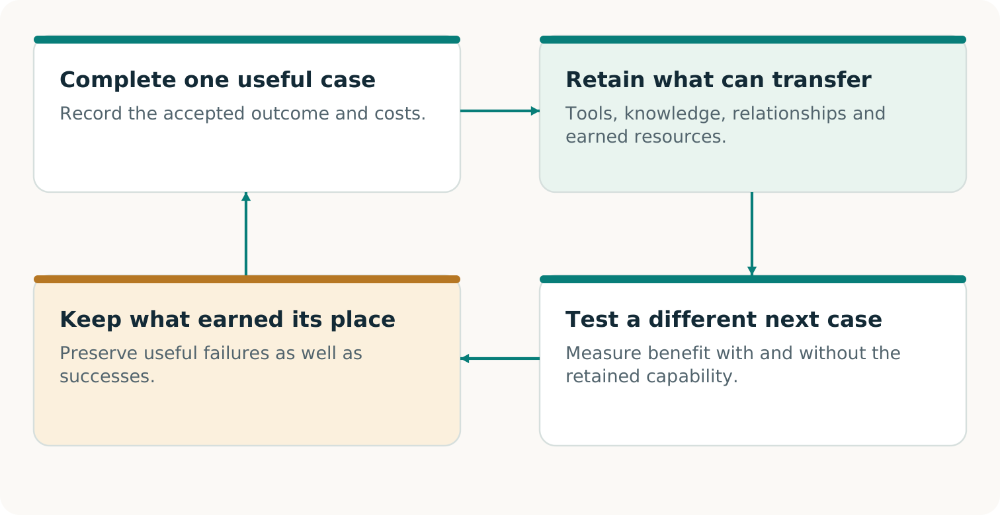

# CONTINUITY Ω

## The story and the method

From a disrupted order to a viable way to deliver

Edition 2 · 7 November 2026

## Start where the customer feels the failure

A customer waiting for a delivery needs the right goods on time. The fact that a server has restarted matters because it may help produce that result. It does not, by itself, settle whether the order is correct, the goods can be made or the customer will receive them.

**CONTINUITY Ω is a project to help a business keep a defined customer promise when its usual route is disrupted.** It investigates what the promise depends on, helps construct missing means and checks whether the resulting arrangement can deliver the agreed outcome. [C1, pp. 5–8]

> **The reference point**
> This customer. This result. This quality. This deadline. These permissions. These acceptance conditions.

That focus creates room for invention. An unavailable application might be restored. A protected record might make the relevant work possible without it. A qualified partner might produce the order while the original site recovers. Each option deserves the same outcome test.

### Where the ambition goes further

Continuity planning already uses alternatives, rehearsals and recovery evidence. The research ambition here is to integrate their discovery and construction with voluntary commercial arrangements—and learn which retained capabilities improve later work. A capable conventional service remains a legitimate winner. [C1, pp. 6, 17–21]

The following pages follow one fictional printer order through that reasoning. They explain the opportunity and the evidence needed to pursue it. The practical volumes then turn the same case into a pilot and editable working records.

## Recover the order the customer accepted

**This continuing case is invented for teaching.** Its quantities, times and financial figures are not reported customers, measurements or prices. The agreed location and time zone remain part of the fictional commitment.

### The accepted order

Deliver 10,000 approved labels, using artwork v3, by Thursday 16:00 at the agreed location.

### The restored record

After the incident, the recovered order book shows 8,000 labels.

### The retained amendment

An authenticated record outside the restored view shows an accepted increase of 2,000 labels.

A process that checks only whether the application opens could miss the discrepancy. A careful comparison with the retained amendment reveals it. The missing 2,000 labels are part of the customer’s accepted order, not optional extra production.

This is why the source of evidence matters. If no available record distinguishes the 8,000-label history from the 10,000-label history, another reviewer cannot infer which actually occurred. The remedy may be a protected acknowledgment or a better record-preservation process. [C1, pp. 9–10]

> **Two clocks matter**
> Service restoration measures when the application can work again. The customer’s deadline measures when the agreed result must be delivered and accepted.

Ordinary reconciliation can find this omission too. CONTINUITY Ω must earn additional value through the complete route it helps construct, the work it saves or the outcome it enables. A fair comparison gives a capable conventional method the same evidence. [C1, pp. 19–20]

## Make the second intelligence useful

One AI can propose a plan; another can search for consequential omissions. Give the challenger a concrete question: **Does the recovered order preserve every accepted change through the agreed cutoff?** In our case, the useful objection identifies the missing 2,000-label amendment and its effect on delivery.

The challenger needs the source, not just the first reviewer’s summary. Its objection must identify a material requirement, a plausible failure and a way to check the allegation. A second model’s confidence is not the deciding evidence. [C1, pp. 5–6, 10–11]

> **Constructive criticism**
> Find the missing condition, settle whether it matters, then build what the accepted outcome requires. Also challenge an unsupported claim that no workable alternative exists.

## Change the means while preserving the agreement

The initial question might be: “How do we restart this plant before Thursday?” The customer’s authorized purpose may permit a broader question: **“How can we deliver the approved labels by Thursday 16:00?”** [C1, p. 5; F1, pp. 2–3]

This is the transformational move: examine whether an inherited way of working is unnecessarily restricting the outcome. Build a different information path, production method or cooperation arrangement when it improves the complete result. Keep the strongest existing route available for comparison.

> **A real boundary**
> If the agreement requires a particular plant, material or approval, that requirement remains binding. Changing it requires an authorized new agreement; it cannot retroactively make the original promise pass. [C1, pp. 8, 10–11; F1, p. 3]

## Give the next provider something it can use

The alternate printer cannot work from the sentence “Please finish our urgent order.” It needs enough reliable information and authority to produce the same approved result. Creating that usable handoff is itself a capability. [C1, pp. 11–12]

### Describe the work

The current 10,000-label obligation, artwork v3, approved material and quality requirements, delivery details and deadline.

### Authorize the work

The necessary use rights, permitted data disclosure, release authority and authenticated way to activate the agreed route.

### Close the loop

Stable order identifiers, amendments, cancellations and receipts that prevent duplicate production or invoicing when normal operations resume.

Portability is about preserving meaning. A file conversion is successful only if the next provider receives the correct specification and can use it under the agreed conditions. A beautiful preview cannot replace a production file that the equipment and operators can actually use.

### Keep the package small and sufficient

Transfer the necessary approved information through the permitted route. Copying the entire affected environment may add exposure without helping production. Current versions, bounded access and a reachable revocation process matter because a once-valid package can become unsuitable.

> **A practical acceptance question**
> Could the receiving provider explain exactly what it is authorized to make, demonstrate that its process can make it, and return evidence that reconciles with the original order?

At this point, the case has progressed from a corrected record to a possible operating route. The next question is whether that route will still be usable when the disruption occurs and other customers need it too. [C1, pp. 11–13]

## Make sure the backup avoids the actual failure

A second printer can still depend on the same failed login, material source or transport link. Another supplier name does not by itself create a usable path. The complete route must survive the disruption being claimed. [C1, pp. 11–12]

In our fictional case, the alternate window has 12,000 units of usable capacity. Earlier protected work already needs 2,000. Exactly 10,000 remain for our order. A further simultaneous request for 5,000 cannot fit without changing the arrangement.

> **A reservation has consequences**
> It commits scarce capacity under defined conditions. Check existing claims and simultaneous demand; maintain the reservation when circumstances change. A report of spare capacity is not a reservation. [C1, pp. 12–13]

## Create an arrangement people can choose

The buyer needs dependable output; the provider needs compensation for capacity and obligations. Preparation, checking and delivery must also be funded. CONTINUITY Ω explores the capability and this voluntary arrangement together. [C1, pp. 17–19; F2, pp. 2–3]

**Fictional CAD: the primary printer’s separate purchase of the continuity service, excluding the end customer’s original invoice.** A quote of $5,600 against estimated complete cost of $5,000 suggests $600 of projected contribution. But $4,700 falls due before acceptance and only $1,200 is available: a $3,500 funding gap.

> **The missing move may be economic**
> A permitted funding sequence, different production route or lower preparation cost could change feasibility. Each change needs its own evidence and cost accounting. A projected contribution does not pay the earlier bills. [C1, pp. 18–19]

## Separate a working route from a proven market

A good continuity service combines an accepted outcome with an arrangement people can sustain. These achievements are connected, but they answer different questions. Keeping them visible helps the buyer know what is being purchased and the provider know what has been earned.

### Outcome

Did the specified work meet the original requirements? For our order, evidence would have to establish the agreed labels, quantity, quality, deadline and acceptance. A software rehearsal establishes only the software result it actually exercised.

### Service feasibility

Can the arrangement be carried out under its stated conditions? Consent, rights, simultaneous capacity, incentives, complete costs and funding timing must fit. A supplied model establishes a conditional calculation; actual readiness needs actual evidence.

### Commercial proof

Do real participants accept the terms and receive the promised value? Record accepted delivery, collected payment, all campaign costs and continuing obligations. Further independent adoption or renewal is needed to support repeatability. [C1, pp. 8, 17–20; F2, p. 3]

This is where a new economic possibility could emerge. A firm unable to justify a duplicate plant might find a qualified, maintained fallback worthwhile. A provider might find that serving such commitments is worthwhile too. Their preferred arrangement must still beat their credible alternatives and remain feasible when demand arrives together.

> **Price the stage that was actually purchased**
> A paid preparation exercise establishes a purchase of preparation. It does not establish acceptance of a later reservation or activation offer. Each stage has its own delivered value and evidence. [C1, pp. 8, 19]

Volume 05 gives the dated picture of the existing evidence. It distinguishes the original research, later local software work and the additional observations required for operational or commercial claims.

## Make the result easy to inspect and use

A Continuity Passport records the promise, exercise, observations and when conclusions need rechecking. It makes the next decision easier. [C1, pp. 13–14]

| Record | What the reader needs |
| --- | --- |
| Commitment | Recipient, output, quantity, quality, deadline, permissions and acceptance authority. |
| Exercise | Route, inputs, versions, disruption, dependencies, concurrent capacity, results and evidence gaps. |
| Verification | Source custody, checker, method, producer relationship and trust assumptions. |
| Use and validity | Terms and capacity status; invoices or collections; costs, duties, expiry, revocation and recheck triggers. |
### Specify the independence

Separate source custody can protect the reference. Separately implemented checking can expose a shared coding mistake. An outside assessor can add organizational separation. These address different risks. Another AI or code path within the same project does not automatically provide external assurance. [C1, pp. 6, 9, 13, 22–23]

> **Read each verdict in its scope**
> Demonstrated: the stated requirements were met in the exercise. Failed: an applicable requirement was violated. Not established: decisive evidence is missing or outside scope.

Reconciliation can be demonstrated while physical delivery remains unestablished. A correct refusal may pass a safety test while the complete promise fails. Fresh verification checks current evidence; a saved Passport records the past. [C1, pp. 13–14; R1; R3]

## Use one capability to make another possible

AI progress may make new tools practical. Suppose a real accepted exercise produces a useful adapter, checking procedure and their validity conditions. A different production process could benefit from that inheritance—or reveal a failed transfer. [C1, p. 21]

ALPHA GENESIS FLYWHEEL Ω asks whether today’s validated construction improves what can be built next. Three gains need separate evidence: earnings fund continuation; inherited means help a new task; an improved discovery procedure performs better across fresh campaigns. [F3, pp. 3, 8, 20]

> **A possible next opportunity**
> Qualified providers could offer maintained, non-conflicting continuity slots to smaller businesses. That is a hypothesis to construct and test, not a market established by this guide. [C1, p. 21]

## Begin with one promise worth preserving

The right starting point is a consequential commitment with a clear acceptance decision. It is small enough to investigate responsibly and important enough that preserving it would matter. The printer case supplies a way to reason; your actual promise supplies the requirements.

1. **Name the outcome.** What must reach whom, at what quality, by when, and who can accept it? Include the records and permissions that make those terms authoritative.

2. **Find the real obstacle.** Compare the strongest available complete routes. Determine whether the blocker is information, technical compatibility, capacity, consent, funding or a combination.

3. **Choose a decisive observation.** Identify the test that could change the decision. Agree its scope, resources and safe operating boundary before carrying it out. [C1, pp. 19–20]

### Keep the choice open

Use an existing service when it provides the better complete result. Construct a missing capability when its prospective value warrants the work. Stop or revise when evidence or economics do not support the next step. A useful method must recognize all three possibilities.

> **What success should leave behind**
> An accepted result—or a clearly established obstruction—plus evidence that makes the next decision easier. When a capability is retained, include where it works, what it costs and what would invalidate it.

### Continue with the working volumes

**Volume 03** develops the pilot around the same fictional order. **Volume 04** supplies editable records for the actual promise, participants, capacity, evidence and economics. **Volume 05** shows which project claims have support at its stated source revision and which need additional observation.

The ambition is concrete: make an important activity possible through a workable arrangement, demonstrate its value, and retain what helps a different promise next. [C1, pp. 21–23]

## Sources

- C1: CONTINUITY Ω. 03_Original_Papers/C1_CONTINUITY_OMEGA_Research_EN.pdf
- F1: Transformational Intelligence. 03_Original_Papers/F1_Transformational_Intelligence.pdf
- F2: Invent the Economy. 03_Original_Papers/F2_Invent_the_Economy.pdf
- F3: ALPHA GENESIS FLYWHEEL Ω. 03_Original_Papers/F3_ALPHA_GENESIS_FLYWHEEL_OMEGA_v2.pdf
- R1: Repository overview. https://github.com/MontrealAI/CONTINUITY/blob/396227d8da2f55f674f479de16089c7ce28ef290/README.md
- R3: Executed qualification results. https://github.com/MontrealAI/CONTINUITY/blob/396227d8da2f55f674f479de16089c7ce28ef290/docs/harness/RESULTS.md
