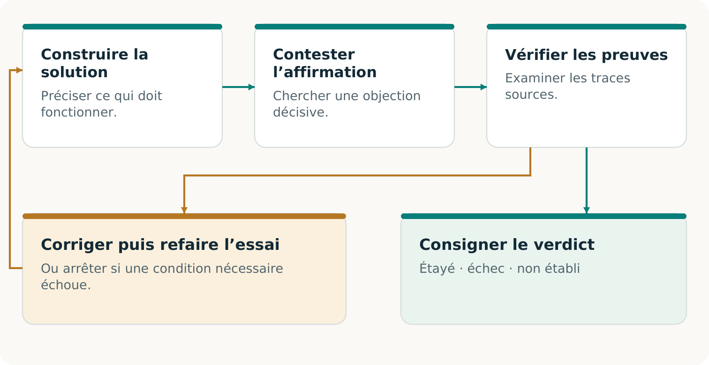

# CONTINUITÉ Ω

## Réaliser le pilote

Une promesse. Une voie utilisable. Un résultat acceptable.

Edition 2 · 7 novembre 2026

## Commencer par une commande qui compte

Un pilote utile répond à une question concrète : **ce client peut-il recevoir le résultat convenu, à temps, lorsque la voie habituelle est indisponible?** Partir de l’acceptation. Identifier les documents, droits, capacités et fonds manquants; construire la solution autorisée; puis éprouver le résultat. [C2, pp. 5–9]

> **Cas illustratif — entièrement inventé**
> Un imprimeur doit livrer 10 000 étiquettes d’emballage approuvées, visuel v3, pour jeudi 16 h, America/Toronto. Le dossier restauré indique 8 000; une modification acceptée ajoute 2 000. La promesse reste inchangée. Le pilote réel devra préciser la date, le lieu de livraison et les spécifications d’acceptation existantes.

### Qui achète?

L’imprimeur touché achète un service de continuité délimité. Son client reste le bénéficiaire de la commande initiale.

### Qui livre et qui vérifie?

Un imprimeur de relève qualifié réalise le travail; l’autorité nommée décide si le résultat respecte les conditions initiales.

### Qui coordonne?

Le responsable du pilote réunit autorisations, réservations, preuves et financement; chaque obligation restante a un titulaire.

Cette démarche de terrain est proposée, sans déploiement rapporté. Le premier pilote réel du dépôt reste lui aussi une proposition sans approbations réelles. Le cahier complémentaire transforme chaque hypothèse en condition acceptée, observation ou lacune visible. [R6]

> **La première décision**
> Choisir une promesse importante et nommer son responsable. Si personne ne peut autoriser ou accepter le résultat proposé, résoudre ce point avant d’offrir la continuité.

## Convenir de ce qui constituera la réussite

Le responsable des opérations prépare la fiche; le dirigeant habilité et l’autorité d’acceptation en arrêtent les conditions. Reprendre l’engagement existant avec ses modifications et annulations. Ne pas inventer un objectif plus commode pour le pilote. La fiche A sert de dossier de travail. [C2, pp. 7–9; R6]

| À fixer | Cas illustratif / décision nécessaire |
| --- | --- |
| Résultat | 10 000 étiquettes selon le visuel v3 et les matériaux, dimensions et tolérances de qualité approuvés. |
| Heure et lieu | Réception et acceptation jeudi à 16 h, America/Toronto, au lieu convenu; ajouter la date réelle. |
| Perturbation déclarée | Préciser les systèmes ou étapes de production indisponibles dans l’exercice contrôlé. |
| Acceptation | Nommer la personne habilitée, la méthode, les preuves et le traitement des résultats partiels ou défectueux. |
| Pouvoirs et limites | Préciser données, participants, interventions, autorité d’arrêt et exclusions. |
### Choisir l’affirmation avant de choisir l’essai

Une simulation sur table peut établir la préparation. Un exercice de production peut inclure des biens réels et leur acceptation client. Un substitut étaye uniquement l’affirmation d’exercice expressément convenue. Distinguer le temps de reprise du délai client : un serveur redémarré ou un colis expédié ne prouve pas une livraison acceptée. [C2, pp. 7–9; R6]

> **Préserver la promesse initiale**
> Si jeudi devient vendredi ou si le client reçoit moins d’étiquettes conformes, évaluer d’abord le résultat selon jeudi et 10 000. Une nouvelle promesse acceptée appartient à une nouvelle version; elle n’efface pas l’échec antérieur.

**Prêt à poursuivre :** les autorités nommées ont accepté version, périmètre et règle d’acceptation. **Sinon :** conserver le projet et résoudre la décision précise qui manque.

## Retrouver ce que la sauvegarde a oublié

Le dépositaire obtient l’historique accepté jusqu’à la borne convenue. L’évaluateur retrouve la modification : 8 000 + 2 000 = 10 000 étiquettes. En produire 8 000 manquerait la promesse. [C2, pp. 9–12]

Le prestataire reçoit visuel approuvé, spécifications, droits, quantité, échéance, destination et pouvoir de lancement. Identifiants stables et annulations préviennent doublons et doubles facturations. Utiliser B à D. [C2, pp. 11–12]

> **Construire le moyen manquant**
> Si les deux imprimeurs dépendent d’un même accès indisponible, qualifier un dossier autorisé accessible séparément et son canal de lancement. Un confrère seul ne supprime pas cette dépendance.

Poursuivre avec des dossiers étayés et utilisables légalement. Preuve décisive absente : NON ÉTABLI. Une empreinte ne prouve pas l’exhaustivité. [C2, pp. 9–10, 14]

## Transformer l’intérêt en réservation utilisable

Demander à chacun sa contribution, sa contrepartie et les preuves rendant l’engagement utilisable. Un imprimeur volontaire sans créneau, un créneau sans visuel approuvé ou un acheteur sans pouvoir d’activation laissent la voie incomplète. Les fiches B et C réunissent ces compléments. [C2, pp. 11–13, 18–19]

| Participant | Engagement nécessaire au pilote |
| --- | --- |
| Imprimeur acheteur | Service accepté, informations permises, pouvoir d’activation et conditions de paiement. |
| Imprimeur de relève | Procédé qualifié, matériaux, créneau précis, confirmation et conditions d’échec ou de retrait. |
| Client final | Spécification applicable, droits nécessaires et autorité d’acceptation nommée. |
| Coordination et évaluation | Responsabilités, contrôles, honoraires et liens déclarés; aucune prime au verdict favorable. |
> **Calcul de capacité illustratif**
> 12 000 unités utilisables − 2 000 unités déjà protégées = 10 000 disponibles. Le pilote remplit exactement le créneau. Une autre activation de 5 000 porterait le total à 17 000, au-delà des 12 000. Ne pas vendre les deux comme couvertures inconditionnelles.

Vérifier réglages, séquence, matériaux, personnel, qualité, transport et demande simultanée. Identifier les dépendances communes à la voie défaillante ou aux autres acheteurs. Obtenir la confirmation réelle du prestataire et vérifier ce qu’inclut son registre. Un tableau local ne révèle pas les réservations non divulguées. [C2, pp. 11–13]

**Prêt à poursuivre :** les parties ont accepté un arrangement complet, actuel et étayé quant à sa capacité. **Sinon :** ajouter une capacité qualifiée, modifier l’arrangement proposé avec consentement ou conserver la limite. Comparer chaque voie à la même promesse client.

## Combler le déficit de trésorerie avant d’engager

Le coordinateur finance le service de continuité distinct acheté par l’imprimeur. La facture initiale au client final reste hors de l’exemple. Tous ces montants, en dollars canadiens, sont inventés. [C2, pp. 18–20]

| Coût illustratif | CAD |
| --- | --- |
| Prospection, préparation et coordination | 1 200 |
| Créneau de production réservé | 700 |
| Production, transport et vérification distincte | 2 800 |
| Suivi et rapprochement | 150 |
| Provision indicative pour imprévus | 150 |
| Coût complet modélisé | 5 000 |
Un prix proposé de 5 600 CAD laisse 600 CAD de contribution modélisée, sans encaissement ni bénéfice réalisé. Les imprévus restent estimatifs, sans plafond des responsabilités.

> **L’offre initiale échoue au financement**
> Paiement proposé après acceptation. Disponibles après protection des obligations : 1 200 CAD. Exigibles avant acceptation : 4 700 CAD. Déficit : 3 500 CAD. La marge ne le finance pas. Ne pas engager réservation ou activation selon ce plan.

Corrections possibles : paiements par étapes acceptés, fonds de roulement autorisés ou voie complète moins chère. Recalculer dépôts remboursables et obligations protégées. E et F conservent le plan échoué et les conditions révisées. [C2, pp. 19–20]

Poursuivre avec accords et fonds couvrant paiements et scénarios d’échec. Inclure ressources du cycle complet, échecs et devoirs restants; signaler les coûts inconnus. [R6]

## Laisser concourir la meilleure voie complète

L’arrangement améliore-t-il assez le résultat complet pour justifier son choix? Donner aux solutions capables la même promesse, les dossiers pertinents, les droits, les possibilités de ressources et les critères d’acceptation. Un prestataire conventionnel peut construire le même dossier transférable et le même accord de capacité. [C2, pp. 19–22]

| Solution | Ce qu’il faut comparer |
| --- | --- |
| Prestataire actuel ou réalisation interne | Une reprise et une fabrication de relève compétentes, coordination, réservations et contrôles compris. |
| Assistance directe par IA | Si accessible et autorisée, une IA utilisée directement avec intrants et budgets totaux équivalents. |
| Voie CONTINUITÉ Ω | Critique explicite, examen des preuves et construction; compter effort supplémentaire et résultat utile. |
| Absence d’achat | L’acheteur peut rationnellement conserver sa solution actuelle. Consigner sa décision réelle et ses raisons. |
### Adapter la preuve à la comparaison

Un devis compare des conditions proposées. Un exercice comparable mesure une exécution observée. Aucun n’établit seul une supériorité générale. Fixer la méthode avant l’essai; distinguer les solutions exécutées, seulement chiffrées ou indisponibles. Ne pas compter une solution non exécutée comme un échec. [C2, pp. 21–22]

Mesurer résultat correct accepté à temps, omissions, doublons, défauts, points non résolus, travail humain, divulgations permises, coût total et besoin de financement. Inclure interventions et échecs. Si l’exercice utilise un substitut, comparer les substituts; réserver la livraison physique aux biens réellement acceptés. [R6]

> **La question d’achat**
> Que gagne l’acheteur par rapport à sa meilleure solution complète, et ce gain vaut-il prix et obligations? Si la voie conventionnelle gagne, l’utiliser. C’est une bonne décision, sans motif pour affaiblir la comparaison.

## Exécuter le travail et consigner les passages de relais

Commencer l’opération convenue lorsque pouvoirs, sources, capacité et financement sont prêts. Le premier pilote proposé est isolé et non destructif. Un exercice de production peut fabriquer et livrer de vraies étiquettes sans lancer d’attaque ni saboter les systèmes. La fiche G suit son déroulement. [R6]

1. Responsable d’exercice : consigner début, versions et dépendances indisponibles. Maintenir les canaux d’arrêt et de contact. Noter toute intervention extérieure à la voie déclarée.

2. Dépositaire et prestataire : transmettre le dossier autorisé, confirmer la commande et vérifier que créneau réservé et intrants restent disponibles.

3. Prestataire et évaluateur : réaliser production et contrôles autorisés; conserver quantités, observations de qualité, heures, défauts, reprises et preuves de transport.

4. Autorité d’acceptation client : consigner réception puis acceptation ou refus selon spécification et échéance fixées. L’expédition ne suffit pas.

5. Coordinateur : distinguer acceptation, factures, encaissements, coûts, remboursements et devoirs résiduels. Émettre une facture ne crée pas son paiement.

> **Arrêter, préserver et décider**
> Appliquer l’arrêt convenu si une autorisation manque, une preuve nécessaire est douteuse, la capacité est indisponible, une obligation n’est pas financée ou une condition de sécurité est violée. Préserver les observations, informer les personnes nommées par le canal autorisé et obtenir la décision. Corriger dans les conditions initiales ou constater l’échec avant tout nouveau périmètre.

Si la voie principale ou une personne non prévue sauve la commande, consigner cette aide. La livraison client peut réussir tandis que l’indépendance annoncée vis-à-vis de cette ressource échoue. Sans travail physique effectué, la livraison réelle reste NON ÉTABLIE. [C2, pp. 8–9, 22; R6]

**Prêt à conclure :** l’autorité habilitée peut examiner ce qui s’est produit, y compris les preuves défavorables et tous les écarts importants au plan.

## Clore par une décision utile

La fiche H distingue résultat, faisabilité du service complet et preuves de marché. Chaque affirmation reçoit DÉMONTRÉ, ÉCHEC ou NON ÉTABLI dans sa portée déclarée. Consigner vérificateur, méthode, sources, liens, limites et changements imposant un nouvel examen. Une autre IA ne crée ni source indépendante ni certification tierce. [C2, pp. 13–15]

| Cas illustratif au point de financement | Conclusion honnête |
| --- | --- |
| Reconstitution de la commande | 8 000 + 2 000 = 10 000 dans l’historique pédagogique. |
| Service complet proposé | Le plan de trésorerie échoue : il manque 3 500 CAD avant acceptation. |
| Résultat client | NON ÉTABLI : l’exemple s’arrête avant l’exécution physique. |
| Preuves de marché | NON ÉTABLI : aucun achat, livraison ou encaissement réel n’est rapporté. |
Le résultat indique ce qu’il faut construire : un arrangement financé et volontairement accepté, ou une meilleure voie complète. Garder le plan échoué. Lorsque les nouvelles conditions sont réellement obtenues, revérifier la promesse initiale avant l’exécution. Les chiffres fictifs ne prouvent aucune disposition à payer. [C2, pp. 18–22]

### Conserver ce qui pourrait servir une autre promesse

Un schéma de commande, adaptateur, mécanisme de réservation ou vérificateur utile se conserve avec ses droits, prérequis, coûts et échecs connus. La fiche I évalue son aide à une tâche nouvelle distincte face à la meilleure voie complète sans lui. Égaliser les ressources initiales et compter la requalification. [C2, pp. 23–24]

> **Trois affirmations différentes pour la suite**
> Une autre vente éprouve la reproductibilité. Une tâche distincte aidée par la capacité conservée éprouve son apport au successeur. Une meilleure découverte sur de nouvelles campagnes sélectionnées indépendamment éprouve la procédure de découverte elle-même. Chacune exige ses preuves.

## Sources

- C2: CONTINUITÉ Ω. 03_Original_Papers/C2_CONTINUITE_OMEGA_Recherche_FR.pdf
- R6: Pilote réel proposé. https://github.com/MontrealAI/CONTINUITY/blob/396227d8da2f55f674f479de16089c7ce28ef290/docs/continuity-omega/REAL_PILOT.md
