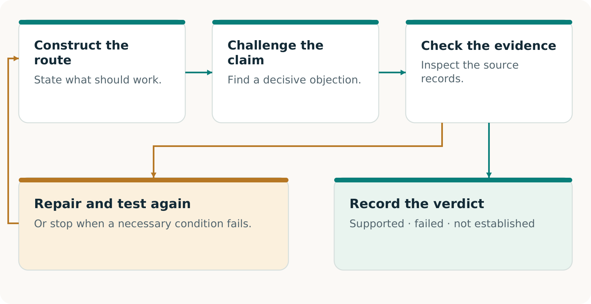

# CONTINUITY Ω

## Make the pilot real

One promise. A usable route. A result someone can accept.

Edition 2 · 7 November 2026

## Begin with an order that matters

A useful pilot answers a concrete question: **can this customer receive the agreed result, on time, when the usual route is unavailable?** Work backwards from acceptance. Identify the missing records, rights, capacity and funding; construct the permitted alternative; then test the result. [C1, pp. 5–8]

> **Illustrative case — invented throughout**
> A printer owes its customer 10,000 approved packaging labels, artwork v3, by Thursday 16:00, America/Toronto. Its restored record shows 8,000. An accepted amendment adds 2,000. The customer’s promise stays unchanged. For a real pilot, bind Thursday to a calendar date, delivery location and the existing acceptance specification.

### Who buys?

The disrupted printer buys a scoped continuity service. Its customer remains the beneficiary of the original order.

### Who delivers and checks?

A qualified alternate printer produces the work; the named acceptance authority decides whether it meets the original terms.

### Who coordinates?

The pilot lead assembles permissions, reservations, evidence and funding, with owners for each remaining duty.

This is a proposed field method, not a report of deployment. The repository’s first real pilot also remains a proposal without actual approvals. Use the companion workbook to turn every assumption into an agreed term, an observation or a visible gap. [R6]

> **The first decision**
> Choose one important promise and name its owner. If nobody can authorize or accept the proposed result, resolve that before offering continuity.

## Agree on what success must mean

The operations lead drafts the promise card; the authorized business owner and acceptance authority settle its terms. Capture the existing commitment, including amendments and cancellations. Do not invent a convenient new objective for the pilot. Workbook A is the working record. [C1, pp. 7–8; R6]

| Freeze this | Illustrative case / required decision |
| --- | --- |
| Result | 10,000 labels using approved artwork v3 and the agreed material, dimensions and quality tolerances. |
| Clock and place | Receipt and acceptance by Thursday 16:00, America/Toronto, at the agreed customer location; add the actual calendar date. |
| Declared disruption | Identify which primary systems or production steps are unavailable inside the controlled exercise. |
| Acceptance | Name the person entitled to accept, the inspection method, evidence and rules for partial or defective output. |
| Authority and boundaries | Specify permitted data, participants, interventions, stop authority and exclusions. |
### Choose the claim before choosing the test

A tabletop exercise can establish preparation. A production rehearsal can include real goods and actual customer acceptance. A substitute output supports only its expressly agreed exercise claim. Record recovery time separately from the customer’s deadline; a restarted server or dispatched parcel does not establish accepted delivery. [C1, pp. 7–8; R6]

> **Keep the original promise intact**
> If Thursday becomes Friday or the customer receives fewer acceptable labels, record the result against Thursday and 10,000 first. A newly agreed promise belongs in a new version; it cannot erase the earlier failure.

**Ready to advance:** the named authorities have agreed on the version, scope and acceptance rule. **Otherwise:** preserve the draft and resolve the exact missing decision.

## Find what the backup forgot

The custodian retrieves accepted history through the agreed cutoff. The reviewer finds the missing amendment: 8,000 + 2,000 = 10,000 labels. Producing 8,000 misses the promise. [C1, pp. 9–11]

The provider needs approved artwork, specifications, rights, quantity, deadline, destination and release authority. Stable identifiers and cancellation rules prevent duplicate production or billing. Record these in B–D. [C1, p. 11]

> **Construct the missing means**
> If both printers need one unavailable login, qualify an authorized, separately accessible package and release channel. Another printer alone has not removed that dependency.

Advance with supported records and a permitted usable package. Missing decisive evidence means NOT ESTABLISHED. Checksums cannot prove source completeness. [C1, pp. 9–10, 14]

## Turn interest into a usable reservation

Ask each participant what they will contribute, what they need in return and what evidence makes the commitment usable. A willing printer without a reserved slot, a slot without approved artwork, or a buyer without activation authority leaves the route incomplete. Workbooks B–C join these complements. [C1, pp. 11–13, 17–18]

| Participant | Commitment needed for this pilot |
| --- | --- |
| Buyer printer | Accepted service scope, permitted information, activation authority and payment terms. |
| Alternate printer | Qualified process, materials, named capacity window, acknowledgement and failure/withdrawal terms. |
| End customer | Applicable specification, necessary permissions and named acceptance authority. |
| Coordinator and reviewer | Execution responsibilities, evidence checks, fees and disclosed relationships; no reward for a favourable verdict. |
> **Illustrative capacity check**
> 12,000 usable units − 2,000 protected existing units = 10,000 available. The pilot fits the stated window exactly. A second 5,000-unit activation would require 17,000 units in total and exceed the 12,000-unit limit. Do not sell both as unconditional coverage.

Check setup, sequencing, materials, people, quality, transport and simultaneous demand. Identify dependencies shared with the failed route or other buyers. Obtain the actual provider acknowledgement and verify what its reservation book does and does not include. A local table cannot reveal undisclosed bookings. [C1, pp. 11–13]

**Ready to advance:** the necessary parties have accepted a current, complete arrangement and its capacity is evidenced. **Otherwise:** add qualified capacity, change the proposed arrangement with consent, or retain the limitation. Preserve the original customer promise in every comparison.

## Resolve the cash gap before committing

The coordinator funds the separate continuity service purchased by the printer. The original customer invoice stays outside this example. All figures below are invented Canadian dollars. [C1, pp. 17–19]

| Illustrative cost | CAD |
| --- | --- |
| Acquisition, preparation and coordination | 1,200 |
| Reserved production slot | 700 |
| Production, transport and separate verification | 2,800 |
| Aftercare and reconciliation | 150 |
| Provisional contingency allowance | 150 |
| Modeled complete cost | 5,000 |
A proposed CAD 5,600 fee leaves CAD 600 modeled contribution. Neither is collected revenue or realized profit. The contingency is an estimate, not a liability limit.

> **The original offer fails its funding test**
> Payment is proposed after acceptance. Available after protected obligations: CAD 1,200. Due before acceptance: CAD 4,700. Gap: CAD 3,500. The margin cannot fund this gap. Do not commit reservation or activation on this plan.

Possible repairs: voluntary milestone payments, authorized working capital or a cheaper complete route. Recalculate refundable deposits and protected duties. Workbooks E–F retain the failed plan and revised terms. [C1, pp. 18–19]

Advance only with accepted terms and available funds covering payment and failure paths. Include lifecycle resources, failures and remaining duties; expose unknown costs. [R6]

## Let the strongest complete route compete

The decision is whether this arrangement improves the complete outcome enough to justify choosing it. Give capable alternatives the same promise, relevant records, permissions, resource opportunities and acceptance rules. A conventional provider may construct the same portable package and capacity agreement. [C1, pp. 18–20]

| Candidate | What to compare |
| --- | --- |
| Incumbent or self-provisioned route | A competent recovery and alternate-production offer, including coordination, reservations and checks. |
| Direct AI-assisted route | Where accessible and authorized, use AI directly with equivalent inputs and total resource budgets. |
| CONTINUITY Ω route | Add explicit challenge, evidence adjudication and construction; count the extra effort and any useful outcome. |
| No purchase | The buyer may rationally retain its present arrangement. Record the actual decision and reasons. |
### Match the evidence to the comparison

A quotation compares proposed terms. A matched rehearsal compares observed execution. Neither alone establishes general superiority. Decide the comparison method before the run; record which candidates were actually run, which were only quoted and which were unavailable. Do not score an unrun candidate as a failure. [C1, pp. 19–20]

Measure accepted correct output by the deadline, omissions, duplicates, defects, unresolved claims, staff effort, permitted disclosures, total cost and funding burden. Include all interventions and failed attempts. If an exercise uses substitute output, compare substitute results; reserve physical-delivery claims for actual accepted goods. [R6]

> **The buying question**
> What does the buyer gain over its best complete alternative, and is that improvement worth the price and obligations? If the conventional route wins, use it. That is a successful decision, not a reason to weaken the comparison.

## Execute the work and record the handoffs

Only begin the agreed operation after authority, sources, capacity and funding are ready. The proposed first pilot is isolated and non-destructive; a real production rehearsal can manufacture and deliver actual labels without launching a cyberattack or sabotaging live systems. Workbook G is the run sheet. [R6]

1. Exercise lead: record the start time, versions and unavailable dependencies. Keep the agreed stop and contact channels reachable. Record every intervention outside the declared route.

2. Source custodian and provider: release the authorized package, acknowledge the order and confirm that the reserved slot and required inputs are still available.

3. Provider and reviewer: perform the authorized production and checks; retain counts, quality observations, timestamps, defects, rework and transport evidence.

4. Customer acceptance authority: record receipt and the actual acceptance or rejection against the frozen specification and deadline. Dispatch alone is insufficient.

5. Coordinator: record the acceptance decision, invoices, collected receipts, costs, refunds and residual duties separately. Payment is not created by issuing an invoice.

> **Stop, preserve and decide**
> Use the agreed stop procedure for missing authority, untrusted required evidence, unavailable capacity, unfunded obligations or a breached safety condition. Preserve observations; notify the named parties through the authorized channel; obtain the next decision. Repair within the original terms or record the failure before agreeing a new scope.

If the primary route or an unplanned person rescues the order, record that assistance. Customer delivery may still succeed, while the claimed independence from that unavailable resource fails. If no physical work is performed, actual delivery remains NOT ESTABLISHED. [C1, pp. 8, 20; R6]

**Ready to conclude:** an authorized acceptance authority can inspect what actually occurred, including adverse evidence and all material departures from the plan.

## Close with a useful decision

Use workbook H to separate outcome, whole-service feasibility and market evidence. Each can be DEMONSTRATED, FAILED or NOT ESTABLISHED within its stated scope. Record the checker, method, sources, relationships, limitations and changes requiring a new check. Another AI is not automatically an independent source or third-party certification. [C1, pp. 13–14]

| Illustrative case at its funding gate | Honest conclusion |
| --- | --- |
| Order reconstruction | 8,000 + 2,000 = 10,000 in the teaching history. |
| Proposed complete service | Fails the stated cash plan: CAD 3,500 is missing before acceptance. |
| Customer outcome | NOT ESTABLISHED: the example stops before physical execution. |
| Market evidence | NOT ESTABLISHED: no real purchase, delivery or collection is reported. |
This result tells the team what to construct next: a voluntarily accepted and funded arrangement, or a better complete route. Keep the failed plan. When revised terms are actually obtained, recheck the original promise before execution. The fictional numbers themselves establish no willingness to pay. [C1, pp. 17–20]

### Retain what could enable a different promise

A useful order schema, adapter, reservation method or checker can be retained with its rights, prerequisites, costs and known failures. Workbook I asks whether it helps a distinct fresh task compared with the strongest complete route without it. Use equivalent starting resources and count requalification. [C1, p. 21]

> **Three different next claims**
> Another sale tests repeatability. A distinct task benefiting from the retained capability tests successor enablement. Better discovery across fresh independently selected campaigns tests improvement of the discovery process itself. Each needs its own evidence.

## Sources

- C1: CONTINUITY Ω. 03_Original_Papers/C1_CONTINUITY_OMEGA_Research_EN.pdf
- R6: Proposed real pilot. https://github.com/MontrealAI/CONTINUITY/blob/396227d8da2f55f674f479de16089c7ce28ef290/docs/continuity-omega/REAL_PILOT.md
