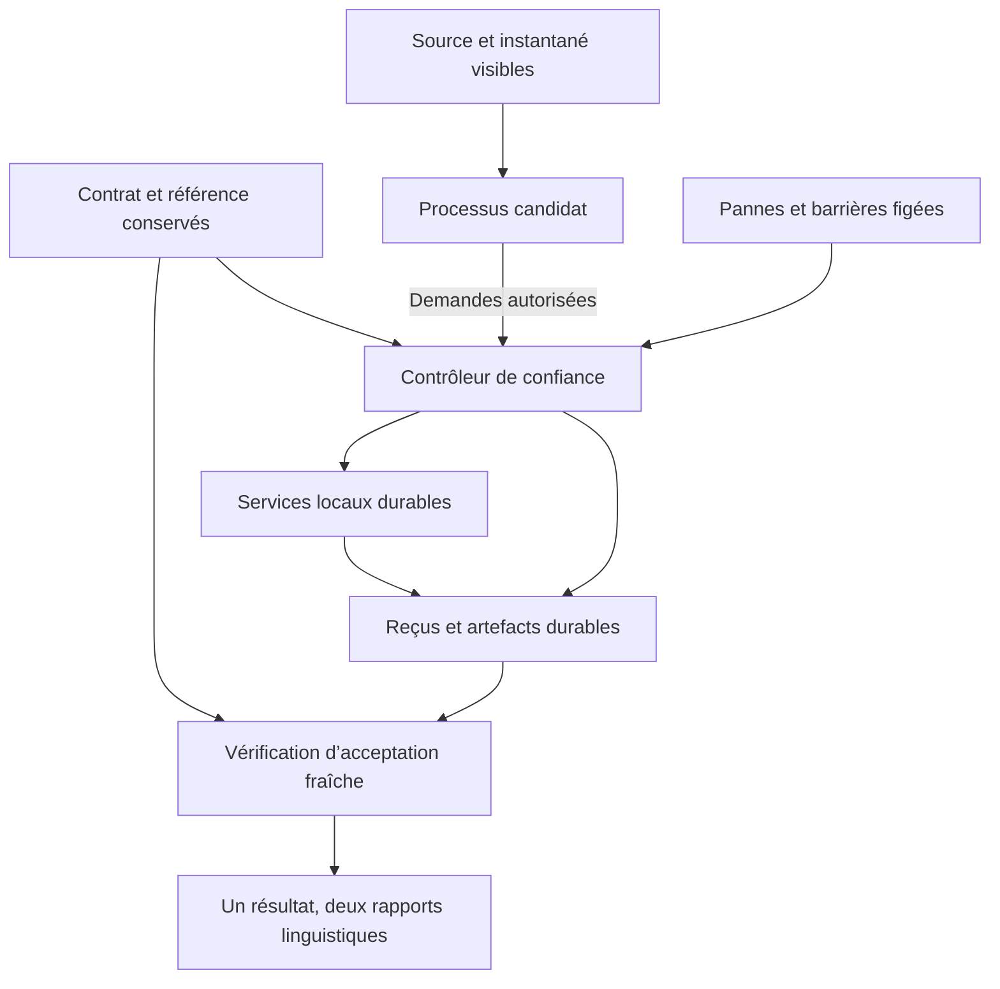

# CONTINUITÉ Ω — Architecture du banc d’essai

[English](ARCHITECTURE.md) · **Français** · [Guide](README.fr.md) · [Modèle de menace](THREAT_MODEL.fr.md)

Ce document décrit l’implémentation [`continuity_harness`](../../continuity_harness/) versionnée séparément. L’état de vérification relève de la [matrice des exigences](REQUIREMENTS.fr.md) et des enregistrements d’exécution ; une description du code ne suffit pas à établir une propriété testée.

## L’unité d’acceptation

L’unité est une obligation préservée : identifiant de commande, destinataire, produit, empreinte de la spécification finale, quantité entière restante et état d’achèvement conformément au contrat conservé. Une commande annulée ne doit pas réapparaître. Une modification ultérieure ne doit pas disparaître. Une commande terminée ne doit pas être exécutée de nouveau.

Le contrat faisant autorité fige l’identité des événements sources et leur borne, la déclaration de complétude, les permissions, les dépendances des voies, les capacités et intervalles de ressources, les objectifs de reprise, les échéances, les versions de schéma et les conditions de comparaison. Une modification légitime crée une nouvelle version du contrat et un nouvel exercice. Elle ne transforme pas rétroactivement un exercice en cours en réussite.

## Responsabilités et confiance

| Rôle | Responsabilité | À ne pas confondre avec |
| --- | --- | --- |
| Autorité de l’exercice | Conserve le contrat original et sa référence hors de l’accès du candidat. | L’authentification d’un vrai client ou la preuve qu’une source rédigée contient toutes les obligations réelles. |
| Contrôleur | Démarre et arrête ses processus, relaie les appels autorisés aux services, applique le calendrier de panne figé, contrôle les horloges d’observation et consigne l’exécution. | Un candidat non fiable ou l’autoévaluation d’un producteur. |
| Adaptateur candidat | Utilise les données et outils visibles pour choisir puis exécuter une voie autorisée. | L’autorité ou l’oracle d’acceptation. |
| Services locaux | Rendent durables la reprise des commandes, les transitions de capacité et les reçus d’exécution. | L’impression physique ou un réseau de fournisseurs externes. |
| Vérificateur d’acceptation | Rejoue indépendamment la source conservée et examine les preuves durables actuelles. | La réutilisation d’un indicateur PASS du producteur ou d’un Passeport enregistré. |
| Générateur de rapports | Présente une même évaluation structurée en anglais et en français. | Une nouvelle vérification du seul fait que la présentation est régénérée. |

## État durable et preuves

Le service local conserve dans SQLite une base de commandes principale, des enregistrements de capacité, des réservations et des reçus d’exécution, en mode WAL avec synchronisation complète. Les transactions SQLite sérialisent les modifications concurrentes. Le candidat accède au service par des messages JSON ligne par ligne relayés par le contrôleur. Le lanceur fournit le chemin réel de l’autorité pour un test de refus, mais le processus confiné ne peut l’ouvrir ni ouvrir un fichier de son espace de travail. La protection de l’autorité repose sur le refus d’accès effectif, pas sur le secret du nom de fichier. Le lanceur et les imports fournis sont de confiance avant le filtrage. Après filtrage, les données arrivent par des messages bornés et tous les effets passent par le relais ; aucun module arbitraire ni accès direct aux fichiers n’est pris en charge.

Un reçu devient durable avant que son accusé de réception soit considéré comme fiable. Son contenu lie l’exécution, le contrat, l’obligation, le destinataire, la spécification finale, la quantité, la voie, la clé stable, l’état d’achèvement, l’instant logique et l’horodatage de transition du producteur. L’export utilise un fichier temporaire, une vidange/synchronisation et un remplacement atomique. Une interruption après validation de la transaction mais avant export crée une incertitude sur l’accusé de réception ou l’export. Le rapprochement lit le reçu durable et termine l’export sans exécuter l’obligation une seconde fois.

Le vérificateur examine à la fois l’artefact obtenu et le reçu durable. Un reçu sans l’artefact requis ne constitue pas automatiquement un travail accepté. Un artefact sans son reçu associé, une commande inattendue, un artefact provenant d’une autre exécution, une quantité modifiée ou un achèvement en double n’est pas accepté.

La vérification fraîche doit observer un état cohérent de la base. Les services se terminent et appliquent le journal à la base avant l’inspection finale. Le vérificateur refuse un journal d’écriture anticipée ou de restauration non vide, plutôt que d’examiner silencieusement un fichier principal périmé. Le sceau conservé `authority/execution.json` lie `controller.json` et les empreintes des octets bruts du manifeste complet des preuves. Il est séparé des fichiers candidats. Le vérificateur exige aussi l’empreinte canonique conservée extérieurement de `authority/reference.json`, qui lie contrat, source, borne et déclaration de complétude.

## Capacité, allocation et exécution

La capacité est un nombre entier d’unités déclarées de travail d’étiquetage, dans des intervalles semi-ouverts `[start, end)`. Il s’agit d’un modèle fini de ressources synthétiques, pas d’une mesure de débit d’impression. Les allocations qui se chevauchent partagent la même capacité. Des intervalles disjoints ne consomment pas simultanément cette capacité.

Le cycle de réservation distingue l’allocation de l’achèvement :

| État | Signification | Traitement de la capacité |
| --- | --- | --- |
| Réservé | La capacité est retenue pour une obligation précise jusqu’à l’expiration de sa réservation. | Compte tant qu’elle est active. |
| Engagé | Le service local a accepté cette allocation pour exécution. | N’expire pas silencieusement au seul motif que le délai de réservation est terminé. |
| Exécuté | Un reçu durable de travail terminé existe. | Continue de compter pendant l’intervalle de capacité déclaré. |
| Libéré | Une allocation admissible non exécutée a été annulée. | Ne compte plus ; une libération répétée ne doit pas soustraire deux fois. |
| Expiré | Une réservation non engagée a atteint son expiration. | Ne compte plus ; une expiration répétée doit être idempotente. |

Les transitions exactes et les codes du service sont des interfaces d’implémentation. Les tests doivent établir que les demandes concurrentes ne surallouent pas la capacité, qu’une clé ne peut pas être réutilisée pour une demande différente et qu’une demande répétée ne duplique pas un travail terminé. Une réduction de capacité ne doit pas masquer les engagements existants ; le retrait d’une voie doit rester visible dans la détermination de ce qui peut encore être exécuté.

L’idempotence lie la clé stable à la demande de réservation complète, à l’exception de l’instant logique actuel d’observation. L’expiration initiale reste dans cette demande : une nouvelle tentative incertaine ne peut pas s’accorder discrètement un nouveau délai. Une demande déjà exécutée renvoie son reçu durable. Il s’agit d’une suppression locale bornée des doublons et d’un rapprochement, pas d’une garantie universelle d’exécution exactement une fois entre systèmes externes.

## Contrats stricts des messages

[`schema.py`](../../continuity_harness/schema.py) accepte une version prise en charge et les champs exacts requis, refuse les champs inconnus et les clés JSON en double, et distingue les booléens des entiers. Quantités, temps logique et unités monétaires mineures utilisent des entiers exacts ; les substituts fractionnaires, non finis, textuels ou booléens sont refusés. Les identifiants sont bornés et excluent la traversée de chemins. Les lecteurs exigent des fichiers ordinaires et rejettent les liens symboliques dans le chemin de lecture protégé.

Le format canonique local utilise du JSON ASCII encodé en UTF-8, des clés triées, des séparateurs compacts, des caractères non ASCII échappés et des nombres entiers. Il ne prétend pas implémenter une autre norme de canonisation. Les entrées JSON sont limitées à 1 048 576 octets, 50 000 nœuds et une profondeur de 32 ; le schéma limite les événements sources à 4 096 et les commandes à 1 024. Les unités et instants logiques sont bornés à 1 000 000 000. Les limites propres aux champs sont vérifiées avant les demandes modifiant l’état. Les codes stables de refus disposent d’explications françaises et anglaises.

## Exécution des pannes

Les pannes sont appliquées à des points de transition et à des barrières consignés. Le contrôleur peut arrêter un vrai processus de travail avant une transaction durable, après validation d’une transaction, pendant l’export d’un artefact ou après rétention d’un accusé de réception. Le redémarrage utilise le même état durable appartenant à l’exercice.

Un test de concurrence libère les demandes simultanées à des points de synchronisation explicites. Des pauses arbitraires ne peuvent pas établir que la concurrence visée a effectivement eu lieu. Un rejeu consigne le calendrier choisi, la graine pertinente, l’ordre des transitions, le processus concerné, son code de sortie et le résultat du rapprochement. Les tests distinguent le calendrier déclaré de l’ordonnancement incontrôlé du système d’exploitation.

Le contrôleur possède le temps logique et les observations de durée. Un candidat ne peut pas rendre ponctuel un travail tardif en fournissant une horloge antérieure. Les unités logiques rendent reproductibles les cas d’échéance et d’expiration. Le temps monotone écoulé mesure l’exécution locale. Les deux sont présentés séparément, avec leurs unités et leurs limites.

L’horodatage du producteur dans le reçu précède la validation et ne peut établir quand l’artefact final durable existait. Le vérificateur associe donc le contenu exact du reçu à une observation de confiance du contrôleur après export/fsync. `completion_ns` est cette borne supérieure prudente après export, relative au début de l’exécution ; `transition_ns` est la transition antérieure distincte du producteur. Une observation durable absente laisse l’achèvement non établi. Une borne dépassant l’échéance réelle est tardive même si la persistance a pu survenir plus tôt : le retard d’observation constitue une limite prudente explicite. L’allocation principale doit aussi suivre une transition durable de restauration, et chaque achèvement doit respecter son propre intervalle réservé.

La durée de reprise en millisecondes est arrondie vers le haut. L’acceptation fraîche compare indépendamment l’observation de confiance exacte `PRIMARY_RECOVERED` à l’objectif inclusif en nanosecondes ; un dépassement d’une nanoseconde ne peut disparaître dans l’arrondi. Une observation absente ou située hors de l’exécution ne qualifie pas la reprise. Le vérificateur reconstitue les obligations par son propre parcours des événements, distinct du calcul d’admission du contrôleur et des parcours du candidat et du service. Les schémas structurels partagés ne fournissent pas la réponse sémantique du producteur comme oracle.

## Méthodes candidates et comparaison

La méthode conventionnelle peut effectuer un rejeu compétent du journal, un rapprochement de base, une réservation transactionnelle et une nouvelle tentative idempotente. Elle reçoit la même source visible, les mêmes opérations de service, capacités, pannes et possibilités d’observation que la méthode accompagnée par le banc d’essai. Cette dernière peut ajouter ses propres vérifications de cohérence ; les preuves d’acceptation cachées demeurent inaccessibles aux deux méthodes.

La méthode d’IA utilise le même contrat d’adaptation. [`LocalAIAdapter`](../../continuity_harness/adapters.py) accepte une capacité locale de décision de confiance explicitement fournie et propose une liste bornée des mêmes opérations autorisées. Aucun modèle, module importé arbitraire, fournisseur réseau ou résultat d’IA rejoué n’est fourni. L’absence de modèle local produit **NOT RUN — NON EXÉCUTÉ** pour la comparaison d’IA. Des décisions synthétiques ne vérifient que l’intégration du protocole. Un vrai modèle exigerait une intégration locale inspectée séparément, avec confinement et observations équivalents, avant de pouvoir participer à une comparaison qualifiée. Des informations supplémentaires, un budget modifié, une aide humaine accrue ou des permissions différentes seraient des facteurs de confusion à signaler.

Une variante réservée à l’évaluation modifie obligations, capacité ou dépendances à travers les mêmes interfaces. L’exécuteur doit déduire ses décisions des entrées ; il ne doit pas contenir la réponse attendue pour cette variante. La réutilisation d’une méthode se distingue de celle d’un contenu. Les coûts d’adaptation mesurés sont présentés ; l’absence de mesure du travail humain reste une inconnue.

## Évaluation et reproductibilité

Chaque résultat structuré sépare l’assertion du test, le verdict du composant, le stade des preuves, l’état de l’affirmation et les résultats par obligation. Une affirmation d’exécution complète exige que chaque obligation soit acceptée dans les conditions conservées. La sûreté et l’exécution complète sont évaluées séparément.

Les épreuves adverses du vérificateur identifient le composant ou la procédure évalué et conservent `TARGET_RESULT.json` séparément de `REFERENCE_RESULT.json`, produit par le vérificateur de référence sans défaut injecté. L’affirmation externe porte sur la propriété déclarée de ce composant. Les faits par obligation restent ceux de la vérification de référence. Un test réussi révélant une acceptation indue indique donc l’échec de l’affirmation du vérificateur défectueux ; il ne transforme pas son verdict cible favorable en résultat de continuité.

Le résultat consigne les identités du contrat et des sources, la révision de l’implémentation, l’environnement, les commandes, le scénario, le calendrier des pannes, les horloges, les observations, les empreintes, les échecs et les lacunes. Les exécutions existantes ne sont pas écrasées. Les tentatives échouées et incomplètes restent des preuves. Les deux rapports linguistiques dérivent de ce même résultat et conservent les identifiants techniques.

Les [preuves de l’article](../continuity-omega-paper/EVIDENCE.fr.md), la [revue](../continuity-omega-paper/REVIEW.fr.md) et le [périmètre de migration](../../MIGRATION.md) restent inchangés. Le motif d’événements de commandes est attribué dans [`fixtures.py`](../../continuity_harness/fixtures.py) à `continuity_omega/demo.py` au commit `8776d70ba091f71dab12fc9d3195baf7fc789676`. Le nouveau service, la liaison à l’autorité, le vérificateur, l’isolement des processus et les rapports disposent de tests exécutables distincts ; les affirmations historiques ne valent pas qualification héritée. Les nombres de tests historiques et ceux du banc d’essai local sont des enregistrements distincts.
