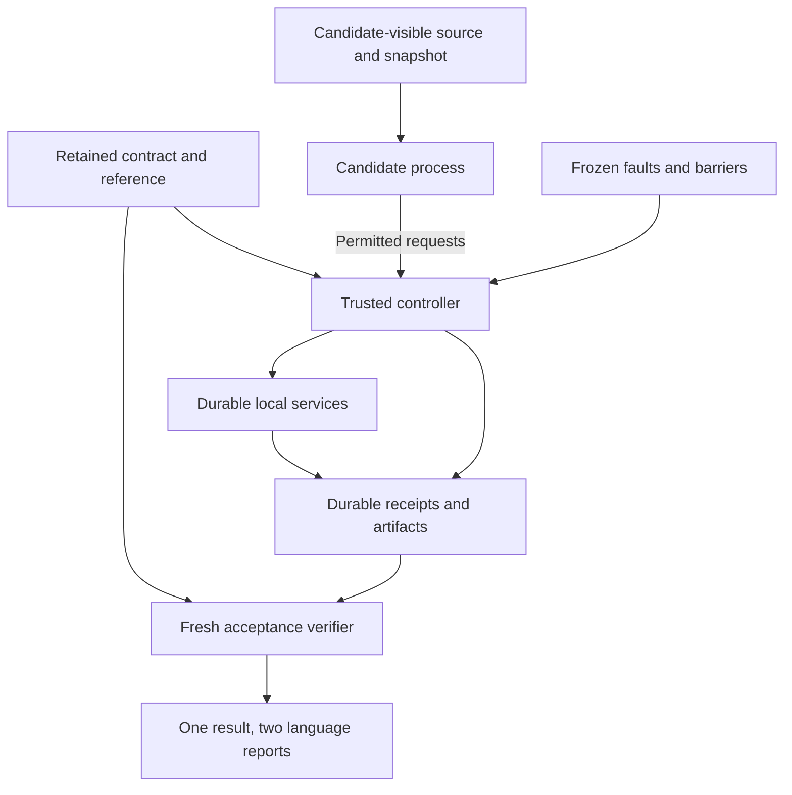

# CONTINUITY Ω Harness — Architecture

**English** · [Français](ARCHITECTURE.fr.md) · [Guide](README.md) · [Threat model](THREAT_MODEL.md)

This document describes the separately versioned [`continuity_harness`](../../continuity_harness/) implementation. Verification status belongs to the [requirements matrix](REQUIREMENTS.md) and execution records; a source description does not by itself establish a tested property.

## The unit of acceptance

The unit is one preserved obligation: an order identifier, recipient, product, final specification digest, outstanding integer quantity, and completion state under the retained contract. A canceled order must not reappear. A later amendment must not disappear. A completed order must not be fulfilled again.

The authoritative contract freezes the source-event identity and cutoff, completeness declaration, permissions, route dependencies, resource capacities and intervals, recovery objectives, deadlines, schema versions, and comparison conditions. A legitimate change creates a new contract version and exercise. It does not modify an already-running exercise into success.

## Responsibilities and trust

| Role | Responsibility | Must not be mistaken for |
| --- | --- | --- |
| Exercise authority | Retains the original contract and its reference outside candidate access. | Authentication of a real customer, or proof that an authored source includes every real obligation. |
| Controller | Starts and stops owned processes, mediates permitted service calls, applies the frozen fault schedule, owns the observation clocks, and records execution. | An untrusted candidate, or a producer's self-assessment. |
| Candidate adapter | Uses candidate-visible records and tools to select and execute a permitted route. | The authority or acceptance oracle. |
| Local services | Persist order recovery, capacity transitions, and fulfillment receipts. | Physical printing or an external supplier network. |
| Acceptance verifier | Independently replays the retained source and inspects current durable evidence. | Reuse of a producer's PASS flag or saved Passport. |
| Reporter | Renders one structured assessment in English and French. | A new verification just because the presentation is regenerated. |

## Durable state and evidence

The local service stores a primary order database, capacity records, reservations, and fulfillment receipts in SQLite with WAL mode and full synchronization. SQLite transactions serialize competing state changes. The candidate reaches the service through controller-mediated JSON-lines messages. The launcher supplies the actual authority pathname for a denial probe, but the confined process cannot open it or any workspace file. Authority protection depends on enforced access denial, not hiding a filename. The shipped launcher and imports are trusted before process filtering. After filtering, candidate data is accepted through bounded messages and all effects use the broker; no arbitrary plugin or direct filesystem access is supported.

A receipt is durable before its acknowledgment is trusted. Its payload binds the run, contract, obligation, recipient, final specification, quantity, route, stable key, completion state, logical tick and producer transition timestamp. The file export uses a temporary file, flush/synchronization, and atomic replacement. Interruption after the database commit but before export is an uncertain acknowledgment/export condition. Reconciliation reads the durable receipt and completes that export without performing the obligation again.

The verifier inspects both the resulting artifact and the durable receipt. A receipt without its required artifact is not automatically accepted work. An artifact without its bound receipt, an unexpected order, a mixed-run artifact, a changed quantity, or a duplicate completion is not accepted.

Fresh verification must observe a consistent database state. Services terminate and checkpoint the database before final inspection. The verifier refuses a nonempty write-ahead log or rollback journal rather than silently inspecting a stale main file. The retained `authority/execution.json` seal binds `controller.json` and the raw byte hashes of the complete evidence manifest. It is separate from the candidate's files. The verifier also needs the externally retained canonical digest of `authority/reference.json`, which binds the contract, source, cutoff, and completeness declaration.

Mutable service files live under `runtime/`. Before shutdown, the controller captures every final service table and requires a complete, nonbusy checkpoint. After every owned process has exited, SQLite's backup API creates a standalone copy in the runtime directory, including committed WAL state rather than merely copying the main file. The destination must use DELETE journal mode, pass integrity and logical-content checks, and exactly match the captured live state. The closed file is synchronized and atomically moved into `evidence/service.sqlite`; both directories are synchronized. No evidence-path database is opened for SQLite writes. Runtime journals remain diagnostic records, while any unexpected journal beside the finalized evidence database still prevents acceptance. This procedure was strengthened after the first comparison's separate verification exposed later-visible stale sidecars; that attempt remains preserved and unqualified.

## Capacity, allocation, and fulfillment

Capacity is an integer count of declared label-work units over half-open intervals `[start, end)`. This is a finite synthetic resource model, not a measurement of a printer's production throughput. Overlapping allocations share the same capacity. Non-overlapping intervals do not consume capacity simultaneously.

The reservation lifecycle distinguishes allocation from completion:

| State | Meaning | Capacity treatment |
| --- | --- | --- |
| Reserved | Capacity is held for a specific obligation until its reservation expiry. | Counts while active. |
| Committed | The local service has accepted that allocation for execution. | Does not silently expire merely because the reservation lease ended. |
| Fulfilled | A durable completed-work receipt exists. | Continues to count for its declared capacity interval. |
| Released | An eligible unfulfilled allocation was canceled. | No longer counts; repeated release must not subtract twice. |
| Expired | An uncommitted reservation reached its expiry. | No longer counts; repeated expiry must be idempotent. |

The exact allowed transitions and service codes are implementation interfaces. Tests must establish that concurrent requests cannot over-allocate, that a key cannot be reused for a different request, and that a repeated request cannot duplicate completed work. Capacity reduction must not hide already encumbered work; route withdrawal must remain visible when determining what can still execute.

Idempotency binds the stable key to the full reservation request except the current observation tick. The original expiry remains part of that request: an uncertain retry cannot quietly grant itself a fresh lease. A repeated fulfilled request returns its durable receipt. This is bounded local duplicate suppression and reconciliation, not universal exactly-once delivery across external systems.

## Strict wire contracts

[`schema.py`](../../continuity_harness/schema.py) accepts a supported version and exact required fields, rejects unknown fields and duplicate JSON keys, and distinguishes Boolean values from integers. Quantities, logical time and currency minor units use exact integers; fractional, non-finite, string and Boolean numeric substitutes are refused. Identifiers are bounded and exclude path traversal. File readers require ordinary files and reject symbolic links through the protected read path.

The local canonical format uses UTF-8-encoded ASCII JSON, sorted keys, compact separators, escaped non-ASCII characters, and integer numbers. It is explicitly not an implementation claim for another canonicalization standard. JSON inputs are bounded to 1,048,576 bytes, 50,000 nodes and depth 32; the schema bounds source events to 4,096 and orders to 1,024. Units and logical ticks are bounded to 1,000,000,000. Declared field-specific limits are checked before state-changing requests. Stable refusal codes have English/French explanations.

## Fault execution

Faults are applied at recorded transition hooks and barriers. The controller can terminate a real worker before a durable transaction, after a transaction commits, while an artifact is being exported, or after an acknowledgment is withheld. Restart uses the same owned durable state.

A race test releases concurrent requests through explicit synchronization points. Arbitrary sleeps cannot establish that the intended race occurred. A replay records the selected schedule, relevant seed, transition order, affected process, exit status, and reconciliation result. Tests must distinguish the declared schedule from uncontrolled operating-system timing.

The controller owns logical time and elapsed-time observations. A candidate cannot make late work timely by supplying an earlier clock value. Logical ticks provide reproducible deadline and expiry cases. Monotonic elapsed time measures local execution. Both are reported separately, with their units and limits.

The receipt's producer timestamp occurs before commit and cannot establish when the final durable artifact existed. The verifier therefore matches the exact receipt payload to a trusted controller observation after export/fsync. `completion_ns` is this conservative post-export upper bound relative to run start; `transition_ns` is the separate earlier producer transition. A missing durable observation leaves completion unestablished. A bound beyond the wall deadline is late even if the underlying persistence might have occurred earlier: observation delay is an explicit conservative limitation. Primary allocation must also follow a durable restoration transition, and each completion must fit its individual reserved interval.

Recovery milliseconds are reported rounded upward. Fresh acceptance independently compares the exact trusted `PRIMARY_RECOVERED` observation with the inclusive recovery objective in nanoseconds; a one-nanosecond overrun cannot disappear through millisecond rounding. Missing or out-of-run observations cannot qualify recovery. Outstanding obligations are reconstructed by the verifier's own source replay, separate from both the controller admission helper and the candidate/service replay. Shared structural schemas do not supply the producer's semantic answer as an oracle.

## Candidate methods and comparison

The conventional method can perform competent journal replay, database reconciliation, transactional reservation, and idempotent retry. It receives the same candidate-visible source, service operations, capacity, fault schedule, and observation opportunities as the Harness-supported method. The Harness-supported method can add its own consistency checks, but hidden acceptance evidence remains inaccessible to both.

The AI method uses the same adapter contract. [`LocalAIAdapter`](../../continuity_harness/adapters.py) accepts an explicitly supplied trusted local decision capability and offers a bounded allowlist of the same tool operations. No model, arbitrary imported plugin, network provider or replayed AI result is supplied. A missing local model yields **NOT RUN** for the AI comparison. Tests using synthetic decisions verify only protocol integration. A real model would require a separately inspected local integration with equivalent confinement and observations before it could qualify for a comparison. Additional information, a changed budget, extra operator help, or different service permissions would be a comparison confound and must be reported.

A held-out variation changes obligations, capacity, or dependency structure through the same interfaces. The executor must derive its decisions from inputs; it must not contain the expected answer for that variation. Reuse of a method and reuse of content are distinguished. Recorded adaptation costs are reported; absent labor measurements remain unknown.

## Assessment and reproducibility

Each structured result carries test assertion, target verdict, evidence stage, claim status, and per-obligation outcomes separately. A claim of complete fulfillment requires every required obligation to be accepted within the retained conditions. Safety success and fulfillment success are assessed separately.

Adversarial checker exercises identify the assessed checker or procedure and retain `TARGET_RESULT.json` separately from the defect-free `REFERENCE_RESULT.json`. Their outer claim concerns that declared component property. Per-obligation facts remain those of the reference verification. A passing test that exposes false acceptance therefore reports the defective checker's claim as failed; it does not promote its favorable target verdict into a continuity result.

The result records the contract and source identities, implementation revision, environment, commands, scenario, fault schedule, clocks, observations, evidence hashes, failures, and gaps. Existing runs are not overwritten. Failed and incomplete attempts remain evidence. Reports in both languages are derived from that same result, with stable technical identifiers.

The historical [paper evidence](../continuity-omega-paper/EVIDENCE.md), [review](../continuity-omega-paper/REVIEW.md), and [migration record](../../MIGRATION.md) remain unchanged. The order-event motif is attributed in [`fixtures.py`](../../continuity_harness/fixtures.py) to `continuity_omega/demo.py` at `8776d70ba091f71dab12fc9d3195baf7fc789676`. The new service, authority binding, verifier, process isolation and reporting have separate executable tests; historical claims are not inherited as qualification. Historical author-test counts and local Harness test counts are distinct records.
