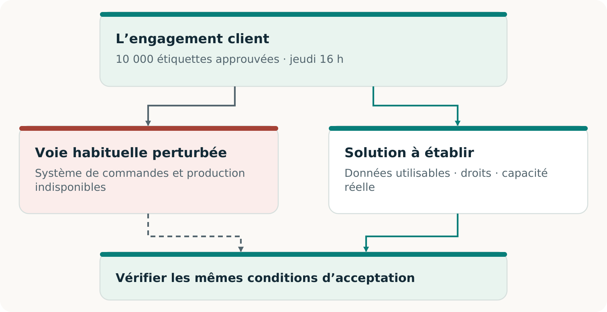
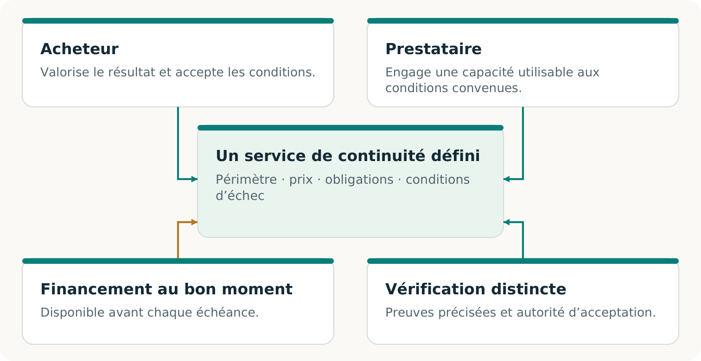
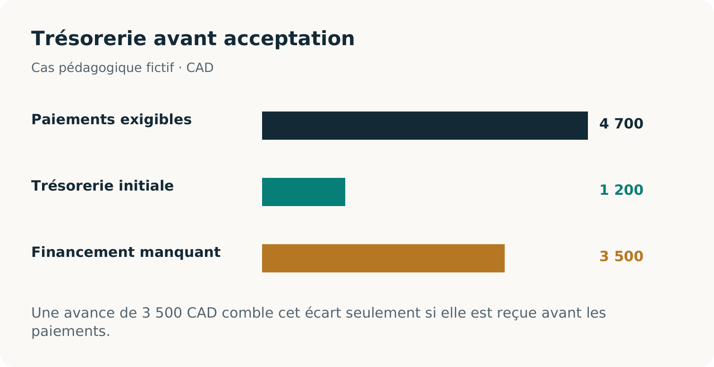
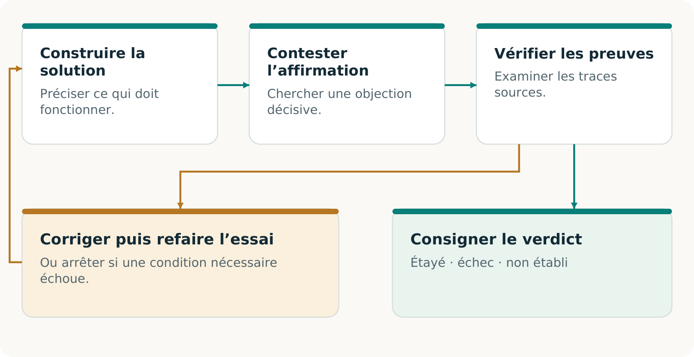
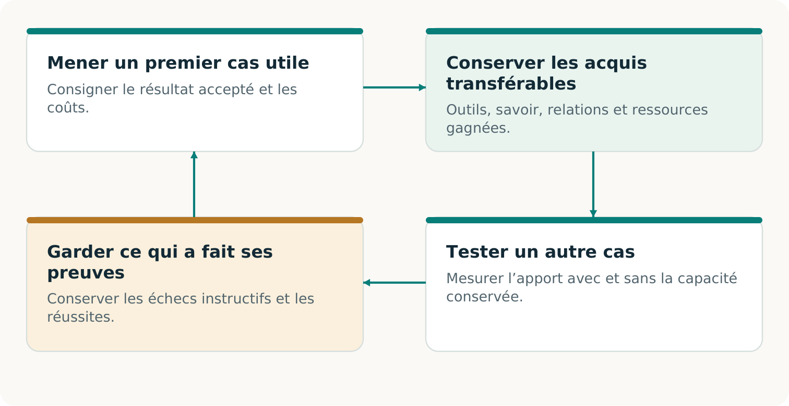

# CONTINUITÉ Ω MasterClass 101
## CONTINUITÉ Ω Masterclass 101
Apprendre à préserver un engagement client et à construire une solution viable

## Ce que vous saurez faire

**CONTINUITÉ Ω est un projet visant à aider une entreprise à tenir un engagement client précis lorsque sa manière habituelle de livrer est perturbée.** Il examine les conditions manquantes, aide à construire une solution utilisable et cherche un arrangement complet auquel les participants peuvent adhérer volontairement. Son ambition de recherche comprend l’apprentissage des capacités conservées qui rendent possibles d’autres travaux. [C2, pp. 5–9, 18–23]

Ce cours transforme cette idée en décisions à pratiquer sans programmer. À la fin, vous devriez pouvoir définir une promesse faisant autorité; réunir informations, droits et ressources dans une solution; vérifier ses coûts et son financement; distinguer ce qu’un essai établit de ce qu’il laisse ouvert; et choisir une prochaine étape utile.

**Votre réponse de départ**
Après une panne, une imprimerie rétablit son application de commandes. L’écran s’ouvre et la sauvegarde se charge. La promesse au client est-elle préservée? Écrivez une phrase et nommez la première preuve que vous demanderiez. Conservez cette réponse pour la fin.

**Comment apprendre ici**
Lisez l’exemple, prenez votre propre décision, puis consultez le retour. Travaillez seul ou à deux. Une réponse utile donne une raison et l’observation qui pourrait modifier la décision.

**Production attendue :** votre réponse initiale. **Suite :** découvrez le cas qui accompagnera le cours. L’horaire animé de 180 minutes comprend une pause de dix minutes; l’autoformation peut demander davantage de temps.

## La commande et les participants

Toutes les entreprises, pièces, sommes et observations de ce cas sont inventées. L’imprimeur A doit livrer des étiquettes d’emballage à son client. Sa voie de production habituelle est perturbée. L’imprimeur B pourrait assurer la relève; un coordonnateur propose d’organiser un service de continuité distinct, acheté par A. La facture initiale du client reste hors du registre financier de ce service.

| Rôle | Ce que ce rôle maîtrise |
| --- | --- |
| Imprimeur A | Commande initiale, divulgation permise et achat du service. |
| Imprimeur B | Procédé, matières, créneau utilisable et engagement de production. |
| Coordonnateur | Solution proposée, registre du service et transmissions. |
| Morgan | Responsable de la réception du client, autorisé à statuer sur l’acceptation. |

La commande acceptée porte sur 10 000 étiquettes, visuel v3, reçues et acceptées au plus tard le jeudi 12 novembre 2026 à 16 h, America/Toronto, à l’entrepôt montréalais fictif, quai 3, site M1. Aucune livraison incomplète ni substitution de qualité n’est autorisée. La prochaine leçon précise la spécification.

**Repérez la différence**
« Le serveur fonctionne », « B peut ouvrir le fichier » et « Morgan accepte toute la commande à temps » sont des affirmations distinctes. Laquelle répond directement à l’exigence du client?

**Retour**
Seule la dernière atteint l’acceptation client. Les deux premières peuvent être nécessaires sans établir le résultat complet. La classe établit votre raisonnement à partir des pièces fournies, pas une livraison réelle ni un marché réel.

**Production :** une carte des rôles et une phrase décrivant le résultat client. **Suite :** rendre ce résultat vérifiable.

## Écrire une promesse que l’on peut accepter

**Objectif**
À partir d’une commande et de ses modifications autorisées, rédiger une fiche permettant à une autre personne d’accepter ou de refuser le résultat.

Une promesse dépasse une aspiration comme « maintenir l’activité ». Elle précise bénéficiaire, résultat, quantité, qualité, échéance, lieu et autorité d’acceptation. L’origine de ces conditions compte : une reconstitution commode ne remplace pas l’entente véritable du client. [C2, pp. 7–10]

| P1 : promesse pédagogique | Condition d’acceptation |
| --- | --- |
| Résultat et quantité | 10 000 étiquettes d’emballage; visuel v3 approuvé. |
| Spécification | Support autoadhésif blanc mat; 50 × 30 mm, tolérance ±0,5 mm; code approuvé lisible. |
| Qualité et intégralité | Les étiquettes endommagées ne comptent pas; aucune acceptation partielle. |
| Échéance et lieu | 12 novembre 2026, 16 h, America/Toronto; site M1, quai 3. |
| Autorité | Morgan, responsable de la réception client, vérifie quantité, spécification, qualité et heure. |

**Exemple résolu**
« Envoyer environ 10 000 étiquettes jeudi » ne tranche pas un différend sur la quantité, l’heure ou la réception. P1 le permet : un avis d’expédition à 15 h 50 ne suffit pas sans réception et acceptation dans le délai.

Une nouvelle entente autorisée peut modifier l’engagement futur. Consignez-en une nouvelle version. Elle ne rend pas rétroactivement conforme à P1 une livraison antérieure incomplète ou tardive. **Suite :** trouver l’historique qui fait autorité.

## Retrouver l’historique accepté

Le point de reprise couvre le mardi 10 novembre à 12 h et indique 8 000 étiquettes. La modification A-02, autorisée ce mardi à 14 h, en ajoute 2 000. Pour cet exercice, le registre de garde C-01 couvre jusqu’à la limite figée — mercredi 11 novembre à 12 h — et ne mentionne aucune autre modification ni annulation. Ce sont des hypothèses pédagogiques imprimées, pas des pièces réelles authentifiées.

**Exemple résolu**
8 000 + 2 000 = 10 000. Les 2 000 supplémentaires appartiennent à la commande acceptée; elles ne sont pas facultatives. Le rapprochement doit couvrir les événements acceptés jusqu’à la limite convenue, y compris les annulations susceptibles de réduire l’obligation.

Une application récupérée peut fonctionner tout en contenant la mauvaise commande. Une empreinte concordante peut montrer que les octets correspondent à une référence; elle n’établit pas que cette référence comprend tous les événements acceptés. Si les preuves disponibles ne permettent pas de distinguer les deux historiques, une autre IA ne peut retrouver le fait absent. [C2, pp. 9–10]

**Deux horloges différentes**
Le délai de reprise concerne le moment où le service fonctionne de nouveau. L’échéance client concerne la réception et l’acceptation du résultat. Le point de reprise décrit l’état récupéré; les modifications acceptées ensuite demandent encore un traitement.

**Vérifiez votre compréhension**
Sans A-02, 8 000 devient-il le bon résultat? Non. La quantité acceptée reste non établie à partir de cette vue incomplète.

**Suite :** remplir la Fiche de promesse avec l’historique qui fait autorité.

## Prendre la première décision d’acceptation

Utilisez P1 et l’historique pédagogique pour rédiger une Fiche de promesse concise. Vous ne créez pas une nouvelle offre : vous préservez l’engagement déjà accepté selon le cas.

1. Indiquez bénéficiaire, quantité de 10 000, visuel, matière et règles de qualité.
2. Associez l’échéance à la date, au fuseau horaire et au lieu de réception. Nommez Morgan et les contrôles d’acceptation.
3. Inscrivez le point de reprise, A-02 et C-01 comme sources de l’exercice, avec leur limite temporelle et leur statut simulé.

**Exercice**
Un message annonce : « Nous avons produit 10 000 étiquettes, dont 200 endommagées. Le camion est parti à 15 h 40. » Cela prouve-t-il P1? Nommez deux observations manquantes ou conditions non respectées.

**Retour**
Cela ne prouve pas P1. Il reste seulement 9 800 étiquettes intactes : la quantité manque, sauf remplacement conforme reçu dans les conditions de P1. L’expédition n’établit ni la réception à temps ni l’acceptation de Morgan. Un total produit plus élevé ne rend pas les étiquettes endommagées acceptables.

**Idée reçue à corriger**
« À peu près suffit pour la continuité. » Cela constitue une autre règle d’acceptation. Le client peut l’accepter volontairement; le verdict initial et la nouvelle entente doivent rester distincts. [C2, pp. 8, 14–15]

**Production :** une Fiche de promesse avec sources et règle d’acceptation. **Autocontrôle :** permet-elle de refuser une livraison tardive, endommagée ou incomplète? **Suite :** chercher une solution qui puisse la respecter.

## Changer les moyens avec un objectif clair

**Objectif**
Repérer une condition manquante, proposer une capacité concrète pour la fournir et préserver l’engagement client faisant autorité.

Avant de choisir un engagement, l’intelligence transformationnelle peut chercher conjointement un résultat plus utile, des moyens réalisables et un arrangement coopératif. L’exercice de continuité fige ensuite la promesse qu’il teste. Dans P1, inventez d’autres moyens ou arrangements; modifier la promesse exige une nouvelle version explicitement acceptée. Celle-ci ne peut effacer un échec antérieur. [F1, pp. 2–3; C2, pp. 5, 10–12]

**Exemple résolu**
La question étroite est : « L’usine redémarrera-t-elle à temps? » La question élargie devient : « Une voie autorisée peut-elle livrer P1 et obtenir son acceptation jeudi à 16 h? » Un autre imprimeur aide seulement si informations, droits, capacité et livraison fonctionnent aussi.

**Suite :** transformer une solution séduisante en moyens réellement utilisables.

## Construire ce que le prestataire peut utiliser

Une capacité manquante est une aptitude précise nécessaire à la solution complète : dossier actuel, canal de transmission permis, adaptateur pour l’équipement de relève ou rapprochement entre réception et commande initiale. Sa valeur vient de ce qu’elle permet dans des conditions connues. [C2, pp. 11–12]

**Exemple résolu**
B possède une machine adaptée, mais ne peut utiliser le fichier propriétaire de A. Une construction proposée convertit le dessin approuvé au format de B, préserve le visuel v3 et la spécification, puis produit une épreuve vérifiable. Il faut valider cette conversion sur le procédé de B; un aperçu plausible ne suffit pas.

| Construire | Ce qui rend le résultat utilisable |
| --- | --- |
| Dossier de production | Quantité actuelle, visuel, spécification, destination et identifiant stable. |
| Transmission autorisée | Destinataire et informations permis, autorité de diffusion et canal joignable. |
| Dossier de clôture | Accusés, modifications, annulations et acceptations aidant à éviter les doublons. |

**Exercice**
Les deux imprimeurs dépendent du même accès indisponible pour obtenir le visuel approuvé. Proposez une construction autorisée qui supprime cette dépendance et nommez son test.

**Retour**
Un dossier actuel protégé et un canal de diffusion distinct sont des candidats plausibles. Vérifiez que le destinataire autorisé obtient et utilise la bonne version sans l’accès défaillant. Un nouveau nom de fournisseur ou une copie périmée n’établit pas cette capacité.

**Suite :** confier à l’IA des tâches de proposition et de critique, en conservant l’autorité des personnes désignées.

## Donner à l’IA une tâche et un contrôle utiles

L’IA peut proposer des voies, assembler un dossier provisoire, repérer des dépendances ou générer un adaptateur candidat. Fournissez promesse, sources pertinentes, permissions et décision recherchée. Un second modèle peut chercher les omissions importantes. L’assurance d’aucun modèle ne décide si la solution fonctionne. [C2, pp. 5–6, 10–12]

| Rôle | Consigne utile |
| --- | --- |
| Proposition | « Prépare une voie pour P1. Précise entrées, autorité, capacité et preuves à chaque transmission. » |
| Critique | « Repère une omission qui pourrait changer l’acceptation. Nomme l’exigence touchée et la source ou le test décisif. » |
| Examen autorisé | Contrôler l’allégation à partir des sources ou observations; la confirmer, la rejeter ou la laisser ouverte. |

**Exemple résolu**
Le modèle critique remarque que le plan imprime 8 000 étiquettes. A-02 confirme l’objection. Le coordonnateur corrige la quantité, puis revérifie capacité, prix et délais. Trouver les 2 000 manquantes commence une réparation; cela ne prouve pas que le service corrigé livrera.

**Exercice**
Améliorez cette critique : « Le plan est risqué et l’IA peut se tromper. » Donnez une exigence précise, une défaillance possible et un contrôle décisif.

**Retour**
Exemple : « P1 exige v3; le dossier indique v2. Comparons la référence autorisée et validons le fichier diffusé sur le procédé de B. » Une objection précise permet une construction ou un refus. Le pessimisme non étayé mérite aussi examen.

Utilisez uniquement données et opérations autorisées. L’IA ne fournit ni consentement manquant, ni historique absent, ni preuve réelle de production. **Suite :** choisir une construction utile et son test.

## Remplir une Fiche de réalisation

Choisissez un obstacle : commande périmée, fichier inutilisable ou accès défaillant partagé. Décrivez une solution qui l’élimine sans modifier P1 en silence. Elle peut combiner services ordinaires, expertise humaine et travail assisté par l’IA. L’option compétente la plus simple reste admissible. [C2, pp. 10–13, 21–22]

1. Nommez la condition bloquante et l’exigence de P1 qu’elle menace.
2. Précisez la construction, la personne qui doit l’autoriser et celle qui l’utilisera.
3. Nommez l’observation prouvant son fonctionnement et l’échec qui arrêterait l’affirmation.
4. Indiquez la condition suivante encore ouverte : capacité, financement ou transport, par exemple.

**Exercice**
Complétez : « Il nous faut ___ pour que ___ puisse ___ dans les conditions ___. Nous le vérifierons par ___. D’ici là, ___ reste non établi. »

**Retour modèle**
« Il faut un dossier de production actuel et permis pour que B réalise P1 sans l’accès défaillant. Nous testerons récupération, version, format et épreuve sur le procédé par le canal distinct. D’ici là, la préparation de la relève reste non établie. » La réponse nomme un résultat utilisable et un test plutôt qu’une simple demande de résilience.

**Idée reçue à corriger**
« Changer les moyens signifie changer la promesse. » Une voie peut être repensée dans les conditions initiales. Un site, une matière ou une approbation obligatoire le reste sans nouvelle entente autorisée.

**Production :** une Fiche de réalisation avec construction, responsable et test. **Suite :** déterminer si les participants nécessaires peuvent et veulent s’engager.

## Une coopération acceptable

**Objectif**
Construire une carte indiquant chaque participant nécessaire, sa contribution, son consentement et sa raison de participer.

Invent the Economy demande comment une activité techniquement possible peut devenir un échange volontaire et viable. La construction manquante peut être économique : périmètre de service utile, offre de réservation, calendrier de paiement ou partage du travail préparatoire. Aucun modèle ne crée automatiquement l’accord des participants. [F2, pp. 2–3; C2, pp. 18–20]

**Exemple résolu**
Une méthode réutilisable de préparation et de contrôle des dossiers pourrait réduire les efforts répétés. De petits mandats de continuité pourraient alors devenir intéressants à offrir. Le prestataire doit encore financer une capacité sans engagements incompatibles; les acheteurs doivent apprécier et choisir réellement le service.

**Suite :** préciser ce que chacun s’engagerait à fournir, puis vérifier qu’une ressource rare n’est pas promise deux fois.

## Transformer l’intérêt en engagements utilisables

B dit : « Cela nous intéresse. » C’est utile, mais cela ne réserve aucun créneau et n’autorise aucune divulgation. L’arrangement précise qui fournit quoi, sous quelles conditions, et ce qui arrive lorsqu’une contribution devient indisponible. Comparez la situation de chacun à ses solutions de rechange crédibles. [C2, pp. 11–14, 18–19]

| Participant | Engagement utilisable |
| --- | --- |
| Imprimeur A | Accepter périmètre et prix; autoriser dossier permis, activation et paiement. |
| Imprimeur B | Confirmer procédé, matières, créneau et déclenchement; préciser expiration et retrait. |
| Morgan / client | Confirmer spécification, permissions et autorité d’acceptation. |
| Coordonnateur / vérificateur | Assumer transmissions, preuves, frais et devoirs restants; divulguer les liens pertinents. |

**Exemple de capacité**
Le créneau offre 12 000 unités utilisables. Le travail antérieur protégé en consomme 2 000. P1 exige les 10 000 restantes. Une autre demande simultanée de 5 000 porterait les engagements à 17 000 : elle ne tient pas.

Un second fournisseur peut partager le même accès défaillant, approvisionnement, transporteur ou approbateur. Examinez la voie complète et le créneau pertinent. Un tableau local ne révèle pas les réservations non divulguées.

**Exercice**
Réparez la proposition surchargée sans supposer que vous pouvez déplacer le travail protégé ou modifier P1. Nommez une construction et sa preuve nécessaire.

**Retour**
Qualifiez une capacité supplémentaire, trouvez un créneau réellement compatible ou proposez un arrangement conditionnel explicitement accepté. Gardez le besoin ouvert tant que capacité et engagements requis ne sont pas établis.

**Suite :** inscrire la solution choisie dans la Carte de l’arrangement.

## Construire votre Carte de l’arrangement

Reprenez votre Fiche de réalisation. Pour chaque contribution essentielle, nommez son responsable, le bénéfice ou la rémunération justifiant sa participation, l’engagement nécessaire et les preuves actuelles. Un bon arrangement relie ces contributions; il ne traite pas tous les intervenants autres que l’acheteur comme des ressources gratuites. [C2, pp. 18–20]

**Exercice**
A accepte un prix; B possède une capacité; le visuel approuvé reste accessible uniquement par l’accès défaillant. Que construire maintenant? Précisez une diffusion autorisée, les consentements nécessaires et la condition rendant l’offre utilisable.

**Retour**
Le prix accepté et le créneau disponible n’éliminent pas cette dépendance informationnelle. Un dossier actuel autorisé et un canal joignable distinct pourraient le faire. Qualifiez-les avec le titulaire des droits et l’opérateur de B, puis actualisez l’arrangement complet. Ne payez pas la réservation en supposant que l’accès se réglera seul.

**Idée reçue à corriger**
« Une bonne simulation signifie qu’il existe un marché. » Un modèle montre les conséquences des hypothèses fournies. Conditions acceptées, échange réalisé et demande répétée exigent d’autres observations. Même un véritable paiement pour la préparation établit uniquement l’achat de cette étape. [F2, p. 3; C2, pp. 8, 20]

**Production :** une Carte de l’arrangement distinguant contributions acceptées, proposées et manquantes. **Autocontrôle :** chacun peut-il refuser, et la proposition respecte-t-elle ses obligations et ses autres options? **Suite :** calculer le coût complet et vérifier le paiement des factures à leur échéance.

## Compter le coût complet du service

**Objectif**
Calculer la contribution projetée, repérer le manque de trésorerie maximal et expliquer les conditions d’une révision financée.

Tous les montants sont fictifs, en dollars canadiens, du point de vue du coordonnateur. A propose d’acheter le service de continuité distinct pour 5 600 $. La facture initiale du client final est exclue. Le modèle suppose ce périmètre de coûts complet et exprimé sur une base cohérente.

| Coût modélisé | CAD | Paiement |
| --- | --- | --- |
| Production de relève | 3 200 | Avant acceptation |
| Dossier préparé et contrôlé | 550 | Avant acceptation |
| Transport | 400 | Avant acceptation |
| Coordination, frais généraux répartis compris | 350 | Avant acceptation |
| Frais d’essai de préparation | 200 | Avant acceptation |
| Inspection finale | 300 | Après acceptation |
| Total | 5 000 | 4 700 avant; 300 après |

**Exemple résolu**
5 600 − 5 000 = 600 $ de contribution projetée. Ce calcul dépend du périmètre, de l’exécution, de l’acceptation et du paiement modélisés. Ce n’est ni une recette encaissée, ni un solde bancaire, ni un bénéfice réalisé.

Un registre réel doit établir son périmètre complet : travail humain, acquisition et tentatives échouées, préparation, ressources techniques ou d’IA, financement, reprises, suivi et devoirs restants, selon le cas. Ne comptez pas deux fois une ressource et ne la dissimulez pas hors du périmètre. [C2, pp. 18–20; F2, p. 6]

La ligne d’inspection indique quand sa facture est payée; elle ne reporte pas les contrôles de qualité requis après l’acceptation. **Suite :** placer factures et encaissements dans le temps.

## Une marge ne suffit pas à payer à temps

L’offre initiale prévoit le paiement après acceptation complète. Le coordonnateur dispose de 1 200 $ après ses obligations protégées. Il doit payer 4 700 $ avant l’acceptation. Le prix promis pour plus tard ne finance pas une obligation antérieure. [C2, pp. 19–20; F2, p. 6]

**Exemple résolu**
Manque initial = 4 700 − 1 200 = 3 500 $. N’activez pas ce plan de paiement. Construisez un autre calendrier accepté, obtenez un fonds de roulement autorisé ou qualifiez une solution complète moins coûteuse.

**Vérifiez votre compréhension**
Un prix plus élevé, toujours payable après acceptation, supprime-t-il ce manque? Non. Il peut améliorer la contribution projetée sans changer les fonds disponibles avant l’échéance des factures.

**Suite :** tester une avance volontaire comme réparation possible.

## Réparer le calendrier sans compter deux fois

Dans la variante financée, A accepte volontairement une avance de 3 500 $, comprise dans le prix de 5 600 $. L’exercice la suppose reçue, encaissée et autorisée pour les coûts préalables non récupérables documentés; les fonds inutilisés sont remboursables. Les 2 100 $ restants deviennent payables seulement après acceptation complète. Ces conditions n’effacent pas les autres devoirs en cas d’échec.

| Branche favorable conditionnelle | Trésorerie, CAD |
| --- | --- |
| Fonds initiaux non engagés | 1 200 |
| Recevoir l’avance +3 500 | 4 700 |
| Payer les coûts préalables −4 700 | 0 |
| Acceptation complète; encaisser +2 100 | 2 100 |
| Payer l’inspection −300 | 1 800 |

**Rapprochement résolu**
Les recettes totales restent 3 500 + 2 100 = 5 600. Le solde de 1 800 comprend les 1 200 initiaux et la contribution modélisée de 600. Traiter l’avance comme recette supplémentaire compterait deux fois une partie du prix.

**Exercice**
Si l’acceptation complète n’arrive pas, pouvez-vous inscrire l’encaissement de 2 100 et annoncer le même solde final? Expliquez en une phrase.

**Retour**
Non. Cette recette dépend de l’acceptation complète et de l’encaissement. Conservez les soldes observés, réels ou simulés, les factures impayées et les obligations de remboursement ou de reprise.

**Suite :** consigner la branche favorable financée et les questions d’échec encore à résoudre. [C2, pp. 19–22]

## Rendre la décision de financement vérifiable

Dans le Tableau des coûts et des fonds, séparez prix proposé, coûts complets modélisés, encaissements, paiements et devoirs restants. Marquez chaque entrée comme supposée, convenue ou observée dans l’exercice. Une avance inscrite sur une facture provisoire n’est pas un encaissement.

1. Retrouvez la contribution de 600 $ et le manque initial de 3 500 $.
2. Inscrivez l’avance dans le prix total, avec utilisation permise et conditions de remboursement.
3. Retrouvez le solde favorable de 1 800 $, dont les 1 200 $ initiaux.
4. Précisez ce qui change si l’acceptation échoue ou si le solde arrive tard.

**Exercice**
Une collègue dit : « La solution est prête : sa trésorerie préalable ne devient jamais négative. » Corrigez cette conclusion sans rejeter la réparation utile.

**Retour**
L’avance répare le calendrier modélisé de la branche favorable. Il faut encore des fonds réellement disponibles, une solution autorisée avec une capacité utilisable, et un traitement des obligations d’échec ou de paiement tardif. Un solde nul avant acceptation n’offre aucune réserve pour un élément non modélisé. La prochaine tâche constructive consiste à résoudre ces conditions, pas à répéter « trop risqué ».

**Idée reçue à corriger**
« Marge, trésorerie et bénéfice sont interchangeables. » Ils décrivent respectivement une différence modélisée, l’argent disponible à un instant et le résultat final après les coûts et obligations applicables. [F2, p. 6; C2, pp. 18–20]

**Production :** un registre rapproché et une décision précise. **Prenez maintenant la pause de dix minutes. Suite :** déterminer les preuves justifiant une affirmation de réussite.

## Dire exactement ce qui est établi

**Objectif**
Attribuer un verdict étayé à une affirmation précise, expliquer son périmètre de preuve et nommer la prochaine observation décisive.

Trois réalisations peuvent progresser ensemble sans devenir interchangeables. Le résultat client concerne l’engagement accepté. La faisabilité du service concerne l’arrangement complet dans ses conditions déclarées. La preuve commerciale concerne ce que de vrais participants ont choisi, reçu et payé. Une colonne ne remplit pas automatiquement les autres. [C2, pp. 8, 14–15, 18–22; F2, p. 3]

| Affirmation | Question à trancher |
| --- | --- |
| Résultat | Le résultat respecte-t-il les conditions d’acceptation initiales? |
| Faisabilité du service | Permissions, capacité, financement et obligations permettent-ils le service complet? |
| Preuve commerciale | De vraies conditions ont-elles été acceptées, la valeur livrée et le paiement encaissé, avec coûts complets et devoirs restants consignés? |

**Exemple résolu**
Un dossier correct peut être démontré alors que la livraison réelle reste non établie. Une commande reçue incomplète peut établir l’échec de P1 même si logiciel et transport ont fonctionné.

**Trois verdicts**
DÉMONTRÉ : exigences annoncées satisfaites dans l’exercice déclaré. ÉCHEC : exigence applicable violée. NON ÉTABLI : preuve décisive absente ou hors périmètre. Une méthode non exécutée reste NON EXÉCUTÉE; cela ne prouve pas son échec.

**Exercice :** classez « le plan semble complet » et « le reçu autorisé indique moins que P1 ». Le premier demande des preuves; le second étaye un échec dans le périmètre du reçu. **Suite :** examiner qui a vérifié, et sur quoi.

## Contrôler le vérificateur et ses sources

Il faut préciser l’objet de l’« indépendance ». Une garde distincte protège la référence; un contrôle programmé séparément peut révéler une erreur commune; un évaluateur externe ajoute une séparation organisationnelle. Ces mesures répondent à des risques différents. Un autre modèle du même projet ne les procure pas automatiquement. [C2, pp. 9–10, 14, 24–25]

**Exemple résolu**
Deux examinateurs lisant le même point de reprise incomplet peuvent s’accorder sur la mauvaise commande. Fournissez C-01 et A-02, puis vérifiez la détection d’un dossier omettant volontairement la modification dans l’exercice isolé.

**Exercice et retour**
Quel est le témoin positif? Un dossier complet et correct que le contrôle devrait accepter. Un vérificateur qui refuse tout n’est pas un test d’acceptation utile.

**Suite :** appliquer ces distinctions aux preuves logicielles publiées du projet.

## Lire les preuves logicielles à leur juste portée

Le dossier v0.2 du dépôt, fixé pour ce cours, rapporte un contenu numérique substantiel de travaux d’étiquetage produit puis transféré à un processus récepteur local distinct. Celui-ci importe le contenu, le contrôle contre sa spécification conservée et consigne l’acceptation. Cela dépasse une simple déclaration du producteur, tout en restant un exercice numérique borné. [R21; R22]

Une réexécution locale distincte a échoué pendant la finalisation des preuves et reste non qualifiée; des contrôles ultérieurs réussis n’effacent pas cet échec. [R46; R47]

| Preuve du dossier | Ce qu’elle établit ou laisse ouvert |
| --- | --- |
| Contenu importé et contrôlé | Résultat logiciel précis; aucune étiquette physique, qualité d’impression ni acceptation d’un client authentique. |
| Règles et monnaie modélisées | Résultats sous hypothèses rédigées; aucun consentement, paiement ou demande réels. |
| Récepteur et vérificateur distincts | Contrôles locaux sous auteurs et hôte partagés; aucune certification tierce. |
| IA NON EXÉCUTÉE | Aucune performance ni supériorité d’IA observée dans ces dossiers. |

**Exercice**
Réécrivez : « Les tests prouvent un marché de continuité physique certifiée indépendamment. »

**Retour modèle**
« L’expérience locale rapportée exerce et vérifie séparément un résultat numérique et des arrangements modélisés; elle n’établit ni livraison physique, ni demande réelle, ni certification tierce. » Cette formulation préserve l’acquis technique sans l’amplifier ni le nier. [R21; R22; R23]

Un Passeport sauvegardé résume une évaluation. Une nouvelle vérification réexamine preuves et référence originale; elle ne crée pas les observations réelles absentes. Garde des sources et hypothèses de confiance restent pertinentes. **Suite :** rédiger votre propre fiche de preuves.

## Transformer le constat en prochaine action

Pour une affirmation, consignez exigence, source ou observation, vérificateur, méthode, résultat, limite et prochaine action. Ajoutez la version et les conditions imposant un nouveau contrôle. Le Passeport de continuité sert à cela : permettre au lecteur de comprendre l’acquis et ce sur quoi il peut compter maintenant. [C2, pp. 14–15]

**Exercice**
Un récepteur autorisé refuse un visuel périmé. Le test de refus fonctionne, mais aucune étiquette correcte n’arrive dans le délai de P1. Écrivez deux verdicts distincts et une prochaine action constructive.

**Retour**
Le contrôle de refus peut être DÉMONTRÉ dans ce test. La livraison complète de P1 est en ÉCHEC. L’action suivante pourrait construire et qualifier le dossier actuel et une production distincte financée; elle ne peut transformer l’échéance initiale manquée en réussite.

**Une critique utile**
Demandez : « Quelle exigence cette preuve pourrait-elle contredire? » Puis : « Quelle construction ou observation permise réglerait le problème? » Conservez les observations défavorables et contrôlez la version réparée. Un avertissement général ne produit ni verdict précis ni réparation.

**Production :** une Fiche des affirmations et des preuves, avec verdict délimité et prochaine décision. **Autocontrôle :** avez-vous séparé test d’un composant, résultat complet, conditions du service et preuve commerciale? Avez-vous nommé l’indépendance réelle et l’observation manquante?

**Suite :** même un arrangement fonctionnel doit justifier son choix face à des solutions compétentes.

## Comparer des solutions capables de gagner

**Objectif**
Concevoir une comparaison équitable et distinguer un résultat utile de la preuve qu’une méthode apporte un avantage.

Une équipe conventionnelle compétente peut rapprocher la même modification, construire un dossier et organiser la relève. Donnez-lui les informations, l’autorité et les possibilités pertinentes. CONTINUITÉ Ω doit justifier son choix par le résultat complet, le travail économisé ou une activité rendue possible, sans rival artificiellement affaibli. [C2, pp. 19–22]

| Candidat | Rendre la comparaison crédible |
| --- | --- |
| Service conventionnel ou existant | Permettre reprise, coordination, production de relève et contrôle compétents. |
| Voie directement assistée par l’IA | Si disponible et autorisée, fournir entrées, outils et possibilités de ressources équivalents. |
| Critique et construction explicites | Compter critique, arbitrage, réparation et vérification supplémentaires, ainsi que leurs bénéfices. |

Conservez P1, accès aux sources, permissions, règles d’acceptation et budgets pertinents comparables. Fixez la méthode avant l’exécution. Distinguez devis, exercices réalisés et candidats indisponibles. L’acheteur peut aussi choisir raisonnablement de ne rien acheter.

**Exemple résolu**
Si seule la nouvelle méthode reçoit A-02, sa meilleure quantité n’isole pas un avantage de méthode. Fournissez la même modification pertinente à la voie conventionnelle et refaites la comparaison dans le périmètre convenu.

**Suite :** choisir les observations susceptibles de modifier réellement le choix.

## Une égalité est une information

Dans la qualification v0.2 rapportée, les procédures conventionnelle et Harness ont obtenu les mêmes résultats de base et prix modélisés. Les deux ont aussi réalisé un successeur modifié précis. Cela étaye des affirmations bornées d’exécution et de transfert, sans établir un avantage supplémentaire de méthode ou d’IA. La comparaison avec l’IA n’a pas été exécutée. [R22]

**Comparaison résolue**
Deux voies autorisées respectent les mêmes conditions d’acceptation. L’une fournit une trace de preuves utile, mais demande davantage de travail humain. La livraison seule ne désigne pas un gagnant. Mesurez l’effort complet et demandez si les preuves supplémentaires changent une décision valorisée par l’acheteur.

| Observer | Pourquoi cela compte |
| --- | --- |
| Résultat correct accepté à temps | Le résultat client complet. |
| Omissions, défauts et questions ouvertes | Les limites cachées par une réussite globale. |
| Travail humain, reprises et vérification | L’effort réellement nécessaire au fonctionnement. |
| Coûts complets, trésorerie et devoirs | Ce que les participants doivent financer et assumer. |

**Exercice**
Faute de modèle autorisé accessible, une voie d’IA est NON EXÉCUTÉE. Peut-on la compter comme plus lente, plus chère ou infructueuse?

**Retour**
Non : sa performance est inconnue. De même, un essai borné et un faible écart de temps n’établissent pas une supériorité fiable. Une préparation ou adaptation non mesurée empêche une conclusion de coût complet. [R21; R22; R23]

**Suite :** rédiger une comparaison pouvant choisir un service existant, la solution construite ou aucun achat.

## Rédiger une Fiche de comparaison

Choisissez la meilleure solution de rechange crédible à votre Fiche de réalisation. Précisez ce qu’une observation comparable devrait montrer pour préférer l’une des options. Le but est une meilleure décision, y compris découvrir qu’un service ordinaire fait déjà bien le travail.

1. Nommez la promesse client et les solutions complètes en concurrence.
2. Donnez à chacune les mêmes sources pertinentes, permissions, conditions d’acceptation et possibilités déclarées.
3. Choisissez les mesures utiles, dont effort total, coûts et financement.
4. Marquez chaque résultat : devis, exécuté, simulé ou NON EXÉCUTÉ. Nommez les lacunes restantes.

**Exercice**
Une proposition annonce « 20 % de mieux » grâce à une étape logicielle plus rapide, mais omet deux heures de préparation manuelle et ne mesure pas la livraison acceptée. Que doit indiquer la fiche?

**Retour**
Consignez l’étape mesurée à sa portée réelle. L’amélioration complète est NON ÉTABLIE. Ajoutez préparation et acceptation, définissez le périmètre, puis recueillez des observations comparables. Un coût ou temps incomplet ne devient pas silencieusement un avantage du service entier. [C2, pp. 21–22]

**Production :** une Fiche de comparaison avec règle de décision définie d’avance. **Autocontrôle :** l’option conventionnelle peut-elle vraiment gagner? Une égalité resterait-elle visible? Un candidat non exécuté garderait-il ce statut?

**Suite :** réunir promesse, construction, arrangement, finances, preuves et comparaison dans une mise en situation sur table.

## Réaliser la mise en situation

**Objectif**
Produire un Passeport défendable : préserver P1, construire la solution manquante, rapprocher les finances et séparer verdicts de résultat, de faisabilité et de preuve commerciale.

Cet exercice sur table utilise les pièces K0–K6, dévoilées progressivement. Aucune entreprise n’est contactée; aucun produit n’est fabriqué; aucun argent ne circule. Lisez chaque pièce comme une hypothèse fournie ou une observation simulée. Votre tâche est de raisonner de façon cohérente, même quand une pièce contredit une proposition favorable.

1. Attribuez les rôles de coordonnateur, imprimeur A, imprimeur B et client/vérificateur. Si vous cumulez des rôles, rendez ce cumul explicite.
2. Ouvrez d’abord K0–K3. Réglez les décisions concernant promesse, sources, solution et arrangement.
3. Ouvrez K4 pour le financement, puis K5 pour le premier résultat. Consignez R1 sans le réécrire.
4. Si le temps le permet, ouvrez K6 comme branche témoin positive distincte, R2. Elle part d’un nouvel état supposé; ce n’est pas une réparation gratuite de R1.

**Avant de découvrir le résultat**
Écrivez l’affirmation à tester et le résultat qui vous obligerait à la réviser. Le reçu décidera ainsi du verdict, plutôt que votre préférence.

**Production attendue :** promesse, réalisation, arrangement et finances alimentent un Passeport. Préparez une explication de deux minutes sur l’échec et la prochaine décision constructive. **Suite :** établir la commande et la voie permise.

## Décider de la commande et de la solution

Utilisez K0–K3. K0 définit P1 et l’autorité de Morgan. K1 fournit le point de reprise, A-02 et C-01. K2 donne le créneau et la demande simultanée supplémentaire. K3 fournit les permissions et engagements à examiner.

1. Reconstituez la quantité jusqu’à la limite figée. Nommez la source comprenant la modification et la couverture supposée.
2. Repérez la construction permettant de transmettre un dossier actuel et utilisable par le canal autorisé. Indiquez toute permission encore absente.
3. Calculez la capacité disponible et traitez la demande supplémentaire de 5 000.
4. Nommez l’observation établissant la préparation de la voie et celle établissant l’acceptation client.

**Retour modèle — après votre décision**
La quantité acceptée est 10 000 : 8 000 + 2 000. C-01 fournit, dans le cas imprimé, la couverture jusqu’à mercredi midi sans autre changement. Le calcul de capacité est 12 000 − 2 000 = 10 000. P1 tient; ajouter inconditionnellement 5 000 surchargerait le créneau.

**Réparation constructive**
Trouvez une capacité qualifiée supplémentaire, un autre créneau réellement compatible ou une offre conditionnelle acceptée. Ne déplacez pas silencieusement le travail protégé. Une permission de partager le fichier n’autorise pas automatiquement la production : examinez séparément ces engagements.

**Point de contrôle :** votre solution nomme dossier réel, autorité et capacité, au-delà de « utiliser B ». Conservez les conditions ouvertes. **Suite :** vérifier si le coordonnateur peut financer la voie convenue.

## Rapprocher la proposition financée

Ouvrez K4. Travaillez dans le registre du service du coordonnateur; la facture initiale du client reste exclue. Conservez d’abord l’offre initiale, puis ajoutez la révision avec avance volontaire comme version distincte.

| Votre calcul | Résultat attendu, CAD |
| --- | --- |
| Prix moins coût complet modélisé | 5 600 − 5 000 = 600 |
| Manque préalable initial | 4 700 − 1 200 = 3 500 |
| Fonds initiaux et avance comprise | 1 200 + 3 500 = 4 700 |
| Après les paiements préalables | 4 700 − 4 700 = 0 |
| Solde conditionnel à l’acceptation complète | 5 600 − 3 500 = 2 100 |

**Exercice**
Expliquez l’utilité du calendrier révisé, puis nommez deux faits qu’il n’établit pas. Consignez utilisation permise de l’avance, remboursement des fonds inutilisés et inspection restant à payer.

**Retour**
Il supprime le manque initial dans la branche favorable fournie parce que l’avance est reçue et disponible avant les factures. Il n’établit ni livraison réelle ni véritable achat. Il n’établit pas davantage le financement de chaque scénario d’échec. Le solde demeure conditionnel, pas déjà disponible.

Une branche réussie et entièrement payée terminerait à 1 800 $ après le paiement final de 300 $. Ces fonds comprennent les 1 200 $ initiaux. N’inscrivez pas le solde favorable avant que les conditions d’acceptation et d’encaissement de la branche soient fournies.

**Point de contrôle :** conservez les deux versions et leurs verdicts de financement distincts. **Suite :** découvrir le premier reçu et actualiser honnêtement la proposition.

## Conserver l’échec et sa facture impayée

Ouvrez K5. Dans R1, le reçu fictif rapporte 9 800 étiquettes conformes dans le délai. P1 en exige 10 000 sans acceptation partielle; Morgan refuse la commande complète. Le solde de 2 100 $, conditionnel à l’acceptation, est retenu. K5 ajoute une facture d’inspection de 300 $, exigible malgré la quantité insuffisante.

**Exercice**
Écrivez le verdict de résultat, les fonds disponibles, l’obligation impayée et le verdict commercial. Proposez une décision utile. N’effacez pas R1 et ne supposez pas qu’une branche ultérieure paie ses factures.

| Dossier R1 | Conclusion défendable |
| --- | --- |
| Résultat P1 sur table | ÉCHEC : 9 800 ne respecte pas 10 000. |
| Trésorerie et dette | Fonds à 0; facture exigible de 300 non financée. |
| Service complet modélisé | ÉCHEC pour cet essai : pas d’acceptation complète; facture exigible de 300 non financée. |
| Livraison et marché réels | NON ÉTABLIS : pièces et événements sont simulés. |

**Retour**
La détection correcte d’un échec peut coexister avec l’échec du résultat client. Conservez reçu, coûts engagés, inspection impayée et devoirs de reprise ou remboursement. Décidez si une réparation autorisée et financée est possible. Si le délai de P1 ne peut être respecté, une nouvelle entente ne rend pas R1 réussi rétroactivement.

**Point de contrôle :** le Passeport consigne un échec utile, pas une réussite atténuée. **Suite :** distinguer une nouvelle branche témoin d’une histoire réécrite.

## Clore le Passeport sans dépasser les preuves

K6 est une **branche témoin positive sur table, distincte, partant d’un nouvel état initial supposé**. Elle possède sa propre autorisation et un reçu fictif de 10 000 étiquettes conformes acceptées par Morgan dans les conditions de P1. Ce n’est ni une réimpression physique, ni une reprise gratuite, ni un financement ou remplacement de R1.

**Exercice**
Si vous exécutez R2, consignez acceptation complète, encaissement simulé de 2 100 $ et paiement de 300 $. Retrouvez le solde de 1 800 $. Sinon, marquez R2 NON EXÉCUTÉE, sans affirmation de résultat.

**Retour**
R2 peut démontrer la branche favorable sur table sous les hypothèses fournies. Livraison physique, consentement véritable, paiement réel et marché viable restent NON ÉTABLIS. R1 conserve son échec, ses coûts, sa dette de 300 $ et ses obligations ouvertes.

- Promesse : avez-vous conservé P1 et sa version faisant autorité?
- Construction : la voie est-elle utilisable, permise et compatible avec les autres demandes?
- Économie : avance comprise, solde conditionnel, fonds initiaux et dette d’échec sont-ils distincts?
- Preuves : chaque verdict précise-t-il son périmètre en conservant le premier échec?

**Production :** un Passeport distinguant R1 et, le cas échéant, R2, puis deux minutes d’explication de la prochaine décision. Ce sont des productions d’apprentissage, pas une certification d’entreprise.

**Suite :** choisir une capacité à conserver pour un autre engagement. [C2, pp. 14–15, 22–23]

## Conserver une capacité, puis tester son apport

**Objectif**
Choisir une capacité réutilisable, préciser son domaine de transfert et concevoir un test équitable sur une autre tâche.

ALPHA GENESIS FLYWHEEL Ω demande si le travail validé laisse plus qu’un résultat ponctuel : outils, savoir, relations ou ressources gagnées pouvant aider à construire une capacité différente. Leur utilité conservée reste une hypothèse jusqu’aux preuves de la prochaine tâche. [F3, pp. 3, 8, 20; C2, p. 23]

**Trois affirmations distinctes**
Les ressources gagnées peuvent financer la suite. Une capacité héritée peut améliorer une nouvelle tâche. Une méthode de découverte améliorée peut mieux réussir dans de nouvelles campagnes. Chacune demande ses preuves; une seconde facture n’établit pas ces affirmations générales.

**Suite :** définir ce qui est réutilisable et ce qu’il faut qualifier de nouveau.

## Un héritage utile a des conditions

Supposons qu’un travail réel accepté produise une méthode maintenue pour rapprocher les modifications approuvées et préparer un dossier contrôlé. Un nouveau client demande ensuite des encarts d’emballage fabriqués par un autre procédé. La méthode pourrait aider; les anciennes étiquettes, l’ancien reçu et la permission de l’ancien client ne deviennent pas les réponses du nouveau cas.

| Conserver si autorisé | Rétablir pour la nouvelle tâche |
| --- | --- |
| Méthode, structure et contrôles | Nouvelle promesse faisant autorité et historique complet. |
| Prérequis et exemples d’échecs connus | Nouvelles matières, équipements, qualités et acceptations à tester. |
| Relations permises et savoir opérationnel | Droits actuels, consentements, capacité et financement. |

**Comparaison résolue**
Donnez à une voie conventionnelle compétente des informations et possibilités de ressources équivalentes. Comparez la nouvelle tâche avec et sans la méthode conservée. Mesurez résultat accepté et effort complet de préparation, adaptation et contrôle. Un modèle familier qui n’économise aucun travail utile n’a pas démontré son avantage.

Une méthode préparatoire réutilisable pourrait réduire le coût des petits mandats. En faire un service exige encore capacité maintenue sans conflits, offre intéressante et vrais acheteurs. Un second client choisissant une offre semblable teste la demande répétée; cela ne prouve pas automatiquement qu’une tâche différente est devenue possible. [C2, p. 23; F3, pp. 8, 20]

**Suite :** concevoir un Test de réutilisation pouvant révéler un transfert utile ou échoué.

## Concevoir le test du prochain usage

Choisissez un acquis de votre mise en situation : méthode de rapprochement des sources, format autorisé, contrôle de capacité ou registre financier et de verdicts. Nommez le nouveau problème qu’il pourrait aider à résoudre et les changements nécessaires.

1. Nommez un autre bénéficiaire, produit ou procédé et son résultat autorisé.
2. Identifiez capacité conservée, version, permissions et prérequis. Préservez les échecs connus.
3. Définissez une comparaison compétente sans cet héritage, avec informations initiales pertinentes et ressources équivalentes.
4. Choisissez les mesures décisives de résultat et d’effort, la prochaine observation et son responsable.

**Exercice**
Une équipe réemploie le même formulaire pour une deuxième vente et annonce une « économie de continuité qui s’améliore elle-même ». Formulez une affirmation plus limitée et le test supplémentaire nécessaire.

**Retour**
Une vente et un encaissement réels peuvent étayer une observation de nouvel achat à ce périmètre. Pour démontrer un héritage utile, montrez l’apport à une tâche distincte. Pour démontrer une meilleure découverte, comparez de nouvelles campagnes avec des alternatives fortes également équipées. Conservez coûts d’adaptation et échecs. [C2, p. 23; F3, pp. 3, 8, 20]

**Production :** un Test de réutilisation dont l’apport annoncé peut être infirmé. Les 600 $ inventés de la mise en situation ne financent aucun projet réel. Il faut des ressources encaissées, libres d’usage après les obligations restantes.

**Suite :** choisir une action concrète dans votre contexte.

## Choisir votre prochaine action

Reprenez votre réponse initiale : « L’application s’ouvre et la sauvegarde se charge. La promesse au client est-elle préservée? » Améliorez-la avec un engagement précis, une preuve nécessaire et une prochaine action.

**Une réponse finale solide**
« L’application rétablie est un composant. Il faut encore établir la commande acceptée complète, une voie autorisée utilisable, capacité et financement, puis réception et acceptation réelles selon les conditions initiales. Je commencerais par examiner l’historique faisant autorité jusqu’à la limite convenue. »

Choisissez un engagement important dans votre contexte. Limitez le premier exercice pour qu’il tranche une question utile : préciser l’acceptation, construire une transmission autorisée manquante ou mener un exercice comparatif avec des participants désignés. Ne commencez pas par promettre une garantie générale.

1. Nommez le résultat réel et la personne pouvant l’autoriser ou l’accepter.
2. Repérez la condition ouverte la plus déterminante.
3. Choisissez une construction ou observation susceptible de changer la décision.
4. Nommez responsable, date et périmètre autorisé. Conservez résultat et limites.

**Votre vérification finale**
Pouvez-vous expliquer pourquoi 10 000 fait autorité, pourquoi 5 000 de plus surcharge le créneau, pourquoi l’avance est comprise dans le prix, pourquoi R1 doit 300, pourquoi R2 ne l’efface pas, et ce qu’un successeur utile doit démontrer? Reprenez toute leçon dont le raisonnement demeure flou.

**Production :** votre Prochaine action et votre réponse initiale révisée. Le cours réussit lorsque vous savez prendre et expliquer une meilleure décision concrète : construire une capacité manquante, choisir un service existant ou arrêter un plan non étayé.

## Sources

C2  Vincent Boucher. CONTINUITÉ Ω. Édition de recherche 1.1.1. 6 novembre 2026. 03_Original_Papers/C2_CONTINUITE_OMEGA_Recherche_FR.pdf
F1  Vincent Boucher. Transformational Intelligence. Learning to Change the Game. October 2026. 03_Original_Papers/F1_Transformational_Intelligence.pdf
F2  Vincent Boucher. Invent the Economy. Transformational Intelligence for Creating Viable Markets. October 2026. 03_Original_Papers/F2_Invent_the_Economy.pdf
F3  Vincent Boucher. ALPHA GENESIS FLYWHEEL Ω. Research edition 2.0. 4 November 2026. 03_Original_Papers/F3_ALPHA_GENESIS_FLYWHEEL_OMEGA_v2.pdf
R21  Économie v0.2 : installation et commandes. https://github.com/MontrealAI/CONTINUITY/blob/56aa3e0ca995cdbbfe46165f0e68edf7c10004dc/docs/economy/README.md
R22  Économie v0.2 : résultats initiaux et chronologie. https://github.com/MontrealAI/CONTINUITY/blob/56aa3e0ca995cdbbfe46165f0e68edf7c10004dc/docs/economy/RESULTS.md
R23  Économie v0.2 : modèle de menace et limites. https://github.com/MontrealAI/CONTINUITY/blob/56aa3e0ca995cdbbfe46165f0e68edf7c10004dc/docs/economy/THREAT_MODEL.md
R46  Correction après revue et échec local conservé. https://github.com/MontrealAI/CONTINUITY/blob/56aa3e0ca995cdbbfe46165f0e68edf7c10004dc/docs/economy/REVIEW_REPAIR.md
R47  Preuves de qualification après revue. https://github.com/MontrealAI/CONTINUITY/blob/56aa3e0ca995cdbbfe46165f0e68edf7c10004dc/evidence/economy-v0.2/review-repair/QUALIFICATION.json
