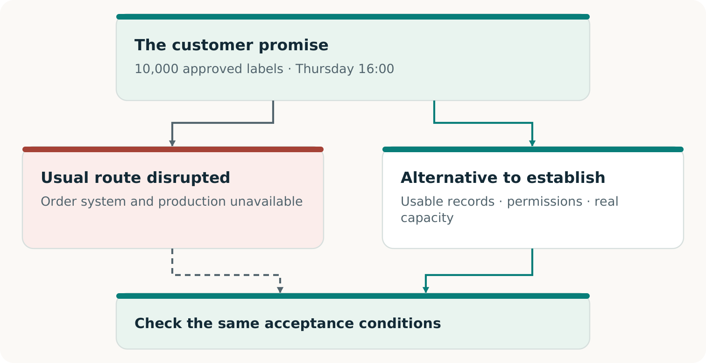
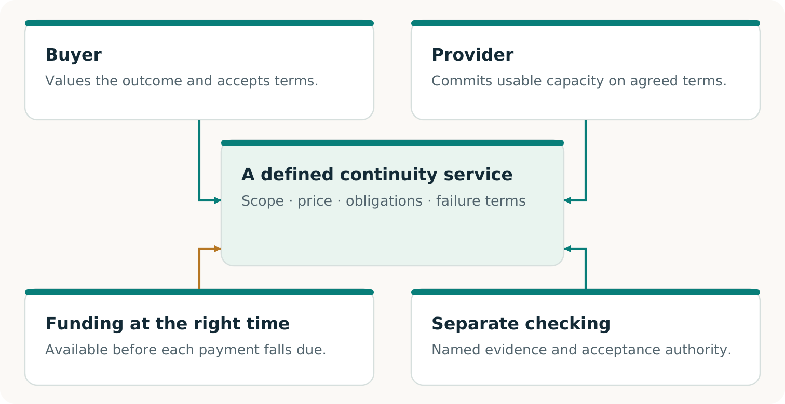
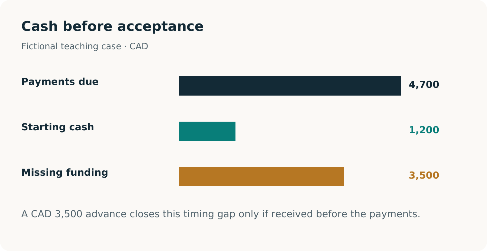
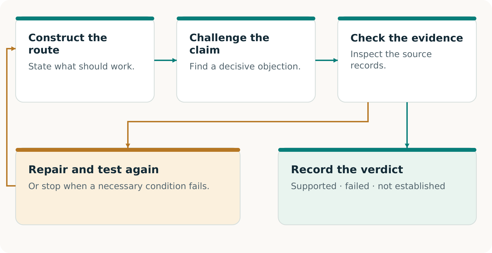
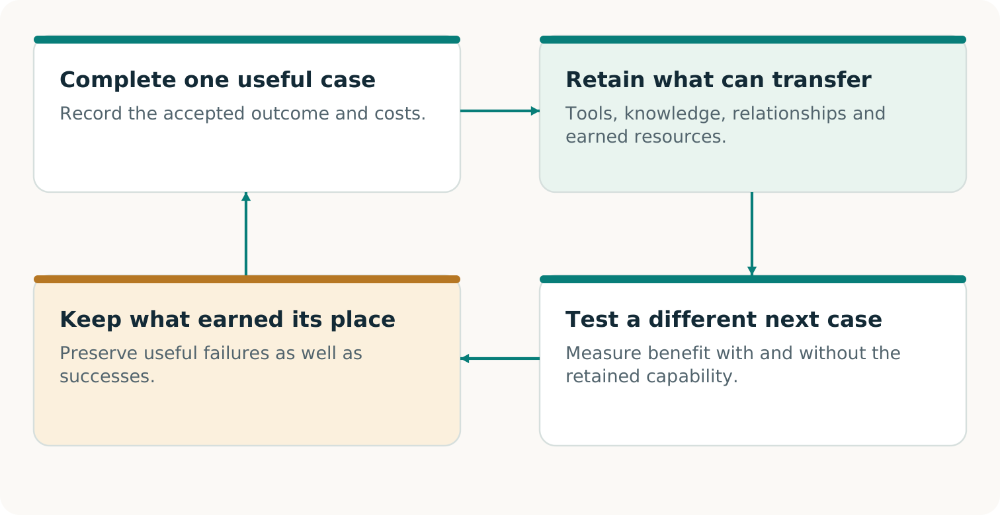

# CONTINUITY Ω MasterClass 101
## CONTINUITY Ω MasterClass 101
Learn to preserve a customer promise and construct a viable way to deliver

## What you will be able to do

**CONTINUITY Ω is a project for helping a business keep a defined customer promise when its usual way of delivering is disrupted.** It investigates the missing conditions, helps construct a usable alternative, and asks whether people can voluntarily support the complete arrangement. Its research ambition includes learning which retained capabilities make different future work possible. [C1, pp. 5–8, 17–21]

This course turns that idea into decisions you can practise without writing code. By the end, you should be able to define an authoritative promise; build a route from records, rights and resources; check its cost and funding; separate what a test established from what it did not; and choose a useful next step.

**Your starting answer**
A printer restores its order application after an outage. The screen opens and the backup loads. Has the customer promise been preserved? Write a one-sentence answer and the first piece of evidence you would request. Keep it for the end of the course.

**How to learn here**
Read the worked example, make your own decision, then consult the feedback. Work alone or with a partner. A useful answer names a reason and the observation that could change it.

**Output:** your baseline answer. **Next:** meet the case that will accumulate decisions throughout the course. The 180-minute live schedule includes a ten-minute break; self-study may take longer.

## Meet the order and the people

Every company, record, price and event in this case is invented for teaching. Printer A owes its customer a packaging-label order. Its usual production route is disrupted. Printer B could provide an alternate route; a continuity coordinator offers to organize the separate continuity service. Printer A would buy that service. The customer’s original invoice is outside our service ledger.

| Role | What the role controls |
| --- | --- |
| Printer A | The original order, permitted disclosure and service purchase. |
| Printer B | Its process, materials, usable slot and production commitment. |
| Coordinator | The proposed route, service ledger and handoffs. |
| Morgan | Customer receiving lead authorized to judge acceptance. |

The accepted order is 10,000 labels, artwork v3, received and accepted by Thursday 12 November 2026 at 16:00, America/Toronto, at the fictional Montréal warehouse, dock 3, site M1. No short shipment or quality substitution is authorized. The next lesson supplies the full specification.

**Find the difference**
“The server is restored,” “Printer B can open the file,” and “Morgan accepts the complete order on time” are different claims. Identify which one directly answers the customer’s requirement.

**Feedback**
Only the last claim reaches customer acceptance. The first two may be necessary steps; neither establishes the complete result. Our classroom can establish what you reasoned from the printed exhibits, not a real delivery or a real market.

**Output:** a role map and one sentence naming the customer result. **Next:** make that result precise enough to test.

## Write a promise someone can accept

**Goal**
Given an order and its authorized amendments, write one promise card that another person can use to accept or reject the result.

A promise is more than an aspiration such as “keep the business running.” It identifies a beneficiary, an output, quantity and quality, a deadline and place, and the authority entitled to accept. The source of those terms matters: a convenient reconstruction cannot replace the customer’s actual agreement. [C1, pp. 7–10]

| P1: the teaching promise | Acceptance condition |
| --- | --- |
| Output and quantity | 10,000 packaging labels; approved artwork v3. |
| Specification | Matte white self-adhesive stock; 50 × 30 mm, tolerance ±0.5 mm; approved code legible. |
| Quality and completeness | Damaged labels do not count; no partial acceptance. |
| Deadline and place | 12 November 2026, 16:00, America/Toronto; site M1, dock 3. |
| Authority | Morgan, customer receiving lead, checks count, specification, quality and time. |

**Worked example**
“Send about 10,000 labels Thursday” cannot settle a dispute about quantity, time or receipt. P1 can: a dispatch notice at 15:50 is insufficient without timely receipt and acceptance.

An authorized new agreement can change the future commitment. Record that as a new version. It does not retroactively make an earlier short shipment or missed deadline conform to P1. **Next:** find which order version actually carries that promise.

## Recover the accepted history

The restored checkpoint covers Tuesday 10 November at 12:00 and shows 8,000 labels. Amendment A-02, authorized at 14:00 that Tuesday, adds 2,000. For this exercise, custodian log C-01 covers through the frozen cutoff—Wednesday 11 November at 12:00—and lists no other amendment or cancellation. These are printed teaching assumptions, not authenticated real records.

**Worked example**
8,000 + 2,000 = 10,000. The extra 2,000 are part of the accepted order. They are not optional spare production. Reconciliation must include the accepted events through the agreed cutoff, including cancellations that could reduce an obligation.

A recovered application can be technically usable while its order is wrong. A file’s matching checksum can show that its bytes have not changed relative to a reference; it cannot establish that the reference contains every accepted event. If no available evidence distinguishes the two histories, asking another AI cannot recover the missing fact. [C1, pp. 9–10]

**Two different clocks**
Recovery time asks when a service can work again. The customer deadline asks when the agreed result must be received and accepted. A recovery point describes the recovered state; accepted changes after that point still need attention.

**Check yourself**
If A-02 is missing, is 8,000 now the right answer? No. The accepted quantity is not established from the incomplete view; the missing evidence remains a task to resolve.

**Next:** use the authoritative history to complete your promise card.

## Make the first acceptance decision

Use P1 and the teaching history to write a compact Promise card. You are not creating a new offer. You are preserving the commitment that the case says was already accepted.

1. State the beneficiary, 10,000-label quantity, artwork and material/quality rules.
2. Bind the deadline to the date, time zone and receiving location. Name Morgan and the acceptance checks.
3. List the checkpoint, A-02 and C-01 as the exercise sources. Mark their cutoff and simulated status.

**Practice**
A message says: “We produced 10,000 labels. Of these, 200 are damaged. The truck left at 15:40.” Decide whether this proves P1. Name two observations you still need or conditions that fail.

**Feedback**
It does not prove P1. Only 9,800 undamaged labels remain, so the stated quantity condition fails unless valid replacements arrive within P1. Dispatch does not establish timely receipt or Morgan’s acceptance. A larger production count cannot make damaged labels acceptable.

**Misconception to retire**
“Close enough is continuity.” Close enough is a different acceptance rule. A customer may voluntarily agree to it, but the original verdict and the new agreement must remain separate. [C1, pp. 8, 13–14]

**Output:** a Promise card with its sources and acceptance rule. **Self-check:** could someone reject a late, damaged or short delivery using only this card? **Next:** search for a route that can satisfy it.

## Change the means with a clear purpose

**Goal**
Identify a missing condition, propose a concrete capability that could supply it, and keep the authoritative customer promise intact.

Before choosing a commitment, transformational intelligence can search jointly for a more valuable outcome, workable means and a cooperative arrangement. A continuity exercise then freezes the authoritative promise it tests. Within P1, invent different means or arrangements; changing the customer promise requires a new explicitly accepted version. That version cannot retroactively rescue an earlier failure. [F1, pp. 2–3; C1, pp. 5, 10–11]

**Worked example**
The narrow question is “Can this plant restart in time?” A broader useful question is “Can an authorized route deliver and obtain acceptance of P1 by Thursday at 16:00?” An alternate printer helps only if the information, rights, capacity and delivery path also work.

**Next:** turn an attractive alternative into something another provider can actually use.

## Construct something the next provider can use

A missing capability is a specific ability the complete route needs. It might be a current order package, a permitted release channel, an adapter for the alternate equipment, or a method that reconciles receipts with the original order. Its value comes from what it enables under known conditions. [C1, pp. 11–12]

**Worked example**
Printer B has a suitable machine, but its operator cannot use Printer A’s proprietary production file. A proposed construction converts the approved design into B’s accepted format, preserves artwork v3 and the specification, and produces a checkable proof. The conversion needs validation on B’s process; a plausible preview alone is insufficient.

| Build | What makes it usable |
| --- | --- |
| Production packet | Current quantity, artwork, specification, destination and stable order ID. |
| Authorized handoff | Permitted recipient, permitted information, release authority and reachable channel. |
| Closure record | Acknowledgment, amendments, cancellation and acceptance records that help prevent duplicates. |

**Practice**
Both printers require the same unavailable login to retrieve the approved artwork. Propose one authorized construction that could remove that dependence. State its test.

**Feedback**
A protected current package and separately reachable release channel are plausible candidates. Test that the authorized recipient can obtain and use the right version without the failed login. Another supplier name or a copied stale file does not establish that capability.

**Next:** use AI to help discover and challenge such constructions, while keeping authority with the named people.

## Give AI a useful job and a check

AI can help propose routes, assemble a draft production packet, identify dependencies or generate a candidate adapter. Give it the promise, relevant source records, permissions and the decision you need. A second model can search for consequential omissions. Neither model’s confidence settles whether the proposed route works. [C1, pp. 5–6, 10–11]

| Role | A useful instruction |
| --- | --- |
| Proposer | “Draft a route for P1. List required inputs, authority, capacity and evidence for every handoff.” |
| Challenger | “Find an omission that could change acceptance. Identify the affected requirement and the source or test that would decide it.” |
| Authorized reviewer | Check the allegation against sources or observations; accept, reject or leave it unresolved. |

**Worked example**
A challenger notices that the proposal prints 8,000 labels. A-02 supports the objection. The coordinator updates the quantity and checks capacity, price and timing again. Finding the missing 2,000 is the beginning of a repair, not proof that the repaired service can deliver.

**Practice**
Improve this critique: “The plan is risky and the AI might be wrong.” Give one precise requirement, possible failure and deciding check.

**Feedback**
For example: “P1 requires artwork v3; the packet names v2. Compare the authorized artwork record and validate the released file on B’s process.” A concrete objection can lead to construction or rejection. Unsupported pessimism should also be challenged.

Use only authorized data and operations. AI does not supply missing consent, source history or real production evidence. **Next:** choose the smallest useful construction and its test.

## Complete a Route card

Choose one obstacle from the case: a stale order, an unusable file, or a shared failed login. Describe a route that removes it without silently changing P1. A route may combine ordinary services, human expertise and AI-assisted work. The simplest capable option remains eligible. [C1, pp. 10–12, 19–20]

1. Name the blocking condition and the P1 requirement it threatens.
2. Specify what you would construct, who must authorize it and who will use it.
3. Name the observation that would show it works and the failure that would stop the claim.
4. List the next unresolved condition: perhaps capacity, payment timing or transport.

**Practice**
Complete: “We need ___ so that ___ can ___ under ___. We will test it by ___. Until then, ___ remains unestablished.”

**Model feedback**
“We need a current, permitted production packet so that Printer B can make P1 without the failed login. We will test retrieval, version, format and a process proof through the separate channel. Until then, alternate production readiness remains unestablished.” This names an artifact and a test rather than merely requesting resilience.

**Misconception to retire**
“Changing the means means changing the promise.” You may redesign a route within the original terms. If a particular site, material or approval is mandatory, it remains mandatory unless an authorized new agreement changes it.

**Output:** one Route card with a construction, owner and test. **Next:** determine whether the people who must supply that route can and will commit to it.

## Make cooperation worth choosing

**Goal**
Build an arrangement map that names each required participant, contribution, consent and reason to participate.

Invent the Economy asks how a technically possible activity could become a voluntary, viable exchange. The missing construction may be economic: a useful service boundary, a reservation offer, payment timing or a way to share preparation work. No participant’s agreement follows automatically from a model. [F2, pp. 2–3; C1, pp. 17–19]

**Worked example**
A reusable method for preparing and checking production packets could reduce repeated setup work. That might make smaller continuity jobs worth offering. The provider still needs funded, non-conflicting capacity; buyers must value and actually choose the service.

**Next:** identify what each party would commit, then check whether the same scarce resources have been promised twice.

## Turn willingness into usable commitments

Printer B says, “We are interested.” That is useful information, but it does not reserve a window or authorize disclosure. The arrangement must say who supplies what, under which conditions, and what happens if a required contribution becomes unavailable. Compare each participant’s position with its credible alternatives. [C1, pp. 11–13, 17–18]

| Participant | A usable commitment |
| --- | --- |
| Printer A | Accept service scope and price; authorize the permitted packet, activation and payment. |
| Printer B | Acknowledge a qualified process, materials, slot and release conditions; state expiry and withdrawal terms. |
| Morgan / customer | Confirm applicable specification, permissions and the acceptance authority. |
| Coordinator / checker | Own handoffs, evidence, fees and remaining duties; disclose relevant relationships. |

**Worked capacity example**
The window contains 12,000 usable units. Protected prior work uses 2,000. P1 needs the remaining 10,000. An additional simultaneous 5,000-unit job would raise total claims to 17,000: it does not fit.

A second supplier can share the same failed login, material source, carrier or approver. Check the complete route and relevant time window. A local reservation table cannot reveal bookings that the provider has not disclosed.

**Practice**
Repair the overloaded proposal without assuming you may displace protected work or change P1. Name one construction and the new evidence it needs.

**Feedback**
Qualify additional capacity, find an actually feasible non-overlapping window, or offer a conditional arrangement the affected parties explicitly accept. Record the unresolved need until the required commitments and capacity are established.

**Next:** turn the chosen repair into an Arrangement map.

## Build your Arrangement map

Use your Route card. For every essential contribution, identify its owner, the benefit or compensation that makes participation worthwhile, the commitment needed, and its present evidence. A good arrangement joins these contributions; it does not treat everyone except the buyer as a free input. [C1, pp. 17–19]

**Practice**
Printer A accepts a price; Printer B has capacity; the approved artwork can be accessed only through the failed login. Which construction comes next? Identify a permitted release solution, who must consent, and the condition under which the offer becomes usable.

**Feedback**
The signed price and available slot do not remove the information dependency. An authorized current package and a separately reachable release channel could do so. Qualify them with the relevant rights holder and B’s operator, then update the complete arrangement. Do not spend a reservation fee on the assumption that access will resolve itself.

**Misconception to retire**
“A good simulation means there is a market.” A modeled arrangement shows consequences of supplied assumptions. Accepted terms, actual exchange and repeat demand require different observations. Even a real payment for preparation establishes only that purchased stage. [F2, p. 3; C1, pp. 8, 19]

**Output:** an Arrangement map with accepted, proposed and missing contributions visibly separated. **Self-check:** can a participant decline, and does the proposal still respect its obligations and alternatives? **Next:** ask what the complete service costs and whether its bills can be paid when due.

## Count the complete service cost

**Goal**
Calculate projected contribution, identify the largest cash shortfall, and explain the conditions of a funded revision.

All amounts in this lesson are invented Canadian dollars from the coordinator’s perspective. Printer A proposes to buy the separate continuity service for CAD 5,600. The end customer’s original order invoice is excluded. This course’s model assumes the following cost scope is complete and on one consistent basis.

| Modeled cost | CAD | Payment |
| --- | --- | --- |
| Alternate production | 3,200 | Before acceptance |
| Prepared and checked packet | 550 | Before acceptance |
| Transport | 400 | Before acceptance |
| Coordination, including overhead allocation | 350 | Before acceptance |
| Readiness test charge | 200 | Before acceptance |
| Final inspection | 300 | After acceptance |
| Total | 5,000 | 4,700 before; 300 after |

**Worked example**
5,600 − 5,000 = CAD 600 projected contribution. That calculation is conditional on the modeled scope, execution, acceptance and payment. It is not collected revenue, a bank balance or realized profit.

A real ledger must establish its own complete boundary: staff time, acquisition and failed attempts, preparation, AI or technical resources, financing, retries, aftercare and remaining duties where applicable. Do not add a resource twice, or hide it outside the boundary. [C1, pp. 17–19; F2, p. 6]

The inspection row states when its bill is paid; it does not postpone required quality checks until after acceptance. **Next:** place the bills and receipts on a timeline.

## A positive contribution cannot pay an early bill

The initial offer pays the coordinator only after full acceptance. The coordinator starts with CAD 1,200 available after its protected obligations. Before acceptance, CAD 4,700 must be paid. The promised later fee cannot fund an earlier obligation. [C1, pp. 18–19; F2, p. 6]

**Worked example**
Early funding gap = 4,700 − 1,200 = CAD 3,500. Do not activate on the initial payment plan. Construct a different sequence that the parties can accept, obtain authorized working capital, or qualify a less costly complete route.

**Check yourself**
Would a higher fee payable only after acceptance remove the early gap? No. It can change projected contribution without changing money available before the bills fall due.

**Next:** test a voluntary advance as one possible repair.

## Repair the timing without counting revenue twice

In the funded teaching extension, Printer A voluntarily agrees to advance CAD 3,500 as part of the CAD 5,600 fee. The exercise assumes it is received, cleared and authorized for documented, nonrecoverable preacceptance costs; unused funds are refundable. The remaining CAD 2,100 is payable only on full acceptance. These terms do not erase other failure duties.

| Conditional success path | Cash balance, CAD |
| --- | --- |
| Opening uncommitted cash | 1,200 |
| Receive advance +3,500 | 4,700 |
| Pay preacceptance costs −4,700 | 0 |
| Full acceptance; collect balance +2,100 | 2,100 |
| Pay final inspection −300 | 1,800 |

**Worked reconciliation**
Total receipts remain 3,500 + 2,100 = 5,600. Ending cash of 1,800 contains the original 1,200 plus the modeled 600 contribution. Calling the advance extra revenue would count part of the fee twice.

**Practice**
Suppose full acceptance does not occur. Can you still enter the 2,100 receipt and claim the same 1,800 ending cash? Explain your answer in one sentence.

**Feedback**
No. The success-path receipt depends on full acceptance and collection. Preserve actual or simulated observed balances, unpaid charges and refund/rework obligations instead of borrowing the favorable branch’s result.

**Next:** record both the funded success path and the failure questions that the offer must still resolve. [C1, pp. 18–20]

## Make the funding decision inspectable

Use the Cost and cash ledger to separate the proposed fee, complete modeled costs, receipts, paid amounts and duties still outstanding. Mark every entry as assumed, agreed or observed in the exercise. A deposit shown on a draft invoice is not a cleared receipt.

1. Reproduce the CAD 600 contribution and CAD 3,500 initial gap.
2. Record the revised advance inside the total fee, with its permitted use and refund terms.
3. Reproduce the successful path to CAD 1,800, including the original CAD 1,200.
4. Write what changes when acceptance fails or the balance arrives late.

**Practice**
A colleague says, “The revised route is ready because its early cash balance never becomes negative.” Give the strongest correction without discarding the useful repair.

**Feedback**
The advance repairs the modeled success-path timing. Readiness still requires the agreed funds to be available, the permission/capacity route to work, and failure and delayed-payment duties to be handled. A zero balance immediately before acceptance also leaves no unmodeled buffer. The constructive next task is to resolve those conditions, not simply repeat “too risky.”

**Misconception to retire**
“Margin, cash and profit are interchangeable.” They answer different questions: the modeled difference, money available at a moment, and the eventual result after the applicable costs and duties. [F2, p. 6; C1, pp. 17–19]

**Output:** a reconciled ledger and a specific funding decision. **Now take the ten-minute break. Next:** decide what evidence would justify claiming the route worked.

## Say exactly what was established

**Goal**
Assign a supported verdict to a precise claim, explain the evidence boundary, and identify the next decisive observation.

Three achievements can grow together without being interchangeable. The customer outcome concerns the accepted result. Service feasibility concerns the complete arrangement under its stated conditions. Commercial evidence concerns what real participants chose, received and paid for. A result in one column does not fill the others automatically. [C1, pp. 8, 13–14, 17–20; F2, p. 3]

| Claim | Question to answer |
| --- | --- |
| Outcome | Did the specified result meet the original acceptance conditions? |
| Service feasibility | Did permissions, capacity, funding and duties permit the complete service? |
| Commercial evidence | Were actual terms accepted, value delivered and payment collected, with complete costs and remaining duties recorded? |

**Worked example**
A correct production packet can be demonstrated while actual delivery remains unestablished. A short received order can establish failure against P1 even if the software and transport ran correctly.

**Use three verdicts**
DEMONSTRATED: stated requirements met within the stated exercise. FAILED: an applicable requirement violated. NOT ESTABLISHED: decisive evidence absent or outside scope. An unrun method is NOT RUN; that is not evidence of its failure.

**Practice:** classify “the plan looks complete” and “the authorized receipt records fewer than P1 requires.” The first is a proposal needing evidence; the second supports an outcome failure within that receipt’s scope. **Next:** examine who checked and what they relied on.

## Check the checker and its sources

“Independent” needs an object. Separate source custody protects the reference; a separately implemented checker can expose a shared coding mistake; an outside assessor adds organizational separation. These address different risks. Another model in the same project does not automatically supply any of them. [C1, pp. 9–10, 13, 22–23]

**Worked example**
Two reviewers reading the same incomplete checkpoint can agree on the wrong order. Give the checker C-01 and A-02, then test whether it detects a packet that deliberately omits the amendment in the isolated exercise.

**Practice and feedback**
What is the positive control? A correct complete packet that the checker should accept. A checker that rejects everything is not a useful acceptance test.

**Next:** apply these distinctions to the project’s published software evidence.

## Read the software evidence at its own scope

The course’s pinned v0.2 repository record reports substantive digital label-job content produced and transferred to a separate local receiving process. The receiver imports the content, checks it against its retained specification and records acceptance. This is stronger than a producer merely declaring completion. It remains a bounded digital-product exercise. [R21; R22]

A separate local replay failed while finalizing evidence and remains unqualified; later passing checks do not erase that failure. [R46; R47]

| Evidence in that record | What it supports or leaves open |
| --- | --- |
| Imported and checked digital content | A specified software outcome; no physical labels, print quality or authentic customer acceptance. |
| Modeled policies and money | Results under authored participant and financial assumptions; no real consent, demand or payment. |
| Separate receiver and verifier | Distinct local checking under shared authorship and host assumptions; no third-party certification. |
| AI marked NOT RUN | No observed AI performance or AI advantage from those records. |

**Practice**
Rewrite “The tests prove a market for independently certified physical continuity” into one defensible sentence.

**Model feedback**
“The reported local experiment exercises and separately checks specified digital completion and modeled arrangements; it does not establish physical delivery, real demand or third-party certification.” A useful narrower statement preserves the technical achievement instead of inflating or dismissing it. [R21; R22; R23]

A saved Passport summarizes an assessment. Fresh verification checks the retained evidence and original reference again; it does not create absent real-world observations. Source custody and the declared trust assumptions still matter. **Next:** write your own claim-and-evidence record.

## Turn a finding into a useful next move

For one claim, record the requirement, source or observation, checker and method, result, limitation and next action. Include the version and conditions that would require rechecking. This is the practical purpose of a Continuity Passport: a reader can understand what was established and decide what can be relied on now. [C1, pp. 13–14]

**Practice**
A permitted receiver refuses an obsolete artwork file. The refusal test behaves as designed, but no correct labels arrive by P1’s deadline. Write two separate verdicts and one constructive next action.

**Feedback**
The refusal control can be DEMONSTRATED for that test. P1’s complete delivery outcome is FAILED. The next action could be to construct and qualify the current packet and a distinct funded production attempt; it cannot convert the missed original deadline into success.

**A useful challenge**
Ask: “Which requirement could this evidence contradict?” Then ask: “What permitted construction or observation would resolve the issue?” Preserve adverse observations and check the repaired version. A generic warning produces neither a clear verdict nor a repair.

**Output:** a Claim and evidence record with a scoped verdict and a next decision. **Self-check:** have you separated a component test, complete outcome, service conditions and commercial evidence? Have you named the actual independence and the missing observation?

**Next:** even a working arrangement must earn its place against capable alternatives.

## Compare routes that could really win

**Goal**
Design a fair comparison and distinguish useful completion from evidence that one method adds value.

A capable conventional team may reconcile the same amendment, construct a production packet and arrange alternate capacity. Give it the relevant records, authority and opportunities needed to do so. CONTINUITY Ω should earn a decision through the complete result, effort saved or newly enabled work—not through an artificially weak rival. [C1, pp. 18–20]

| Candidate | Keep the comparison credible |
| --- | --- |
| Conventional or existing service | Permit competent recovery, coordination, alternate production and checking. |
| Direct AI-assisted route | Where available and authorized, provide equivalent inputs, tools and total resource opportunities. |
| Explicit challenge and construction | Count the extra critique, adjudication, repair and verification effort as well as any benefit. |

Keep P1, source access, permissions, acceptance rules and relevant resource budgets comparable. Record the method before execution; distinguish quoted offers, actual rehearsals and unavailable candidates. The buyer may also reasonably choose no purchase.

**Worked example**
If only the new method receives A-02, its better quantity does not isolate a method advantage. Supply the same relevant amendment to the conventional route and repeat the comparison within the agreed scope.

**Next:** decide which observations could actually change the choice.

## A tie is information

In the reported v0.2 qualification, the conventional and Harness procedures obtained the same base outcomes and modeled prices. Both also completed one specified changed successor. These observations support bounded execution and transfer claims; they do not establish incremental method or AI advantage. The AI comparison was not run. [R22]

**Worked comparison**
Suppose two authorized rehearsal routes meet the same acceptance conditions. One adds a useful evidence trail but also requires more staff time. Do not announce a winner from delivery alone. Measure the complete burden and ask whether the additional evidence changes a decision the buyer values.

| Observe | Why it can matter |
| --- | --- |
| Accepted correct output by the deadline | The complete customer result. |
| Omissions, defects and unresolved claims | Limits hidden by an aggregate pass. |
| Human work, retries and verification | The actual effort needed to make the route work. |
| Complete costs, cash and duties | What participants must fund and carry. |

**Practice**
An AI route has no accessible authorized model and is marked NOT RUN. May you count it as slower, more costly or unsuccessful?

**Feedback**
No. Its performance is unobserved. Likewise, one bounded run and a small timing difference do not establish reliable speed superiority. Unknown preparation or adaptation effort prevents a complete-cost conclusion. [R21; R22; R23]

**Next:** write a comparison that could select an existing service, the constructed route, or no purchase.

## Make a Comparison card

Choose the strongest credible alternative for the Route card you created. State what a matched observation would need to show before you would prefer one option. The purpose is a better decision, including discovering that an ordinary service already does the job well.

1. Name the customer promise and the complete competing routes.
2. Give each route the same relevant records, permissions, acceptance conditions and declared opportunities.
3. Choose the measurements that matter to the decision, including total effort, cost and funding.
4. Mark each result as quoted, run, simulated or NOT RUN. Name remaining gaps.

**Practice**
A proposal claims “20% better” because its software step is faster, while it omits two hours of manual preparation and does not measure accepted delivery. What should the comparison card say?

**Feedback**
Record the measured software step at its actual scope. Complete improvement is NOT ESTABLISHED. Include preparation and acceptance work, define the comparison boundary, and collect matched observations. Do not silently turn an incomplete cost or time figure into a whole-service advantage. [C1, pp. 19–20]

**Output:** a Comparison card with a predeclared decision rule. **Self-check:** could the conventional option genuinely win under that rule? Would a tie remain visible? Would an unrun candidate stay unrun?

**Next:** combine the promise, constructed route, arrangement, ledger, evidence and comparison in one tabletop capstone.

## Run the tabletop capstone

**Goal**
Produce a defensible Capstone Passport: preserve P1, construct the missing route, reconcile the ledger, and report separate outcome, feasibility and commercial verdicts.

This is a tabletop exercise using staged exhibits K0–K6. No company is contacted, no goods are manufactured and no money moves. Read each exhibit as a supplied assumption or simulated observation. Your task is to reason consistently from it, including when it contradicts a favorable proposal.

1. Assign the roles of coordinator, Printer A, Printer B and customer/checker. With fewer people, combine roles but state the overlap.
2. Open K0–K3 first. Complete the promise, source, route and arrangement decisions.
3. Open K4 for the payment plan, then K5 for the first outcome. Record the first run, R1, without rewriting it.
4. If time permits, open K6 as a separate positive-control tabletop branch, R2. It starts from a fresh assumed state; it is not a free repair of R1.

**Before opening the outcome**
Write the claim you expect to test and the result that would force you to revise it. This makes the receipt evidence, rather than your preference, decide the verdict.

**Output for the capstone:** the Promise card, Route card, Arrangement map and ledger feed one Passport. Be ready to explain a failure and a constructive next decision in two minutes. **Next:** establish the order and the permitted route.

## Decide the order and the route

Use K0–K3. K0 defines P1 and Morgan’s authority. K1 supplies the checkpoint, A-02 and C-01. K2 supplies the capacity window and the additional simultaneous request. K3 supplies the permission and production commitments to inspect.

1. Reconstruct the quantity through the frozen cutoff. Identify the source that includes the amendment and the source coverage you are assuming.
2. Identify the route construction needed to deliver a current, usable packet through the authorized channel. List any remaining missing permission.
3. Calculate available capacity and decide what to do about the additional 5,000-unit request.
4. Name the observation that would establish the route’s readiness and the one that would establish customer acceptance.

**Model feedback — read after your decision**
The accepted quantity is 10,000, from 8,000 + 2,000. In the printed case, C-01 supplies coverage through Wednesday noon with no other change. The capacity arithmetic is 12,000 − 2,000 = 10,000. P1 fits; admitting the additional 5,000 unconditionally would overbook the same window.

**Constructive repair**
Find additional qualified capacity, a genuinely feasible different window, or a consented conditional offer. Do not quietly displace protected work. Do not treat a permitted file share as automatic authority to activate production: read the commitments separately.

**Checkpoint:** your route names the actual packet, authority and capacity—not just “use Printer B.” Retain unresolved conditions. **Next:** determine whether the coordinator can fund the agreed route.

## Reconcile the funded proposal

Open K4. Work from the coordinator’s service ledger. The original customer invoice remains outside it. First retain the initial offer; then add the voluntary advance revision as a separate proposal version.

| Your calculation | Expected value, CAD |
| --- | --- |
| Fee less complete modeled cost | 5,600 − 5,000 = 600 |
| Initial preacceptance gap | 4,700 − 1,200 = 3,500 |
| Opening cash plus included advance | 1,200 + 3,500 = 4,700 |
| After preacceptance outflows | 4,700 − 4,700 = 0 |
| Balance still conditional on full acceptance | 5,600 − 3,500 = 2,100 |

**Practice**
Explain why the revised timeline is useful, then name two facts it does not establish. Record the advance’s permitted use, any unused-funds refund duty and the remaining inspection charge.

**Feedback**
It removes the initial gap on the supplied success path because the advance is received and available before the bills. It does not establish actual delivery or a real purchase. It also does not establish that every failure path is funded. The balance is conditional, not money already available.

A successful fully paid branch would end at CAD 1,800 after the CAD 300 final payment. That balance includes the initial CAD 1,200. Do not enter the favorable ending balance until the branch’s acceptance and collection conditions are supplied.

**Checkpoint:** preserve both plan versions and their different funding verdicts. **Next:** open the first receipt and use it to update the proposal honestly.

## Keep the failure and its unpaid bill visible

Open K5. In R1, the mock receipt records 9,800 conforming labels by the deadline. P1 requires 10,000 with no partial acceptance; Morgan rejects the complete order. The CAD 2,100 acceptance-dependent balance is withheld. K5 also supplies an inspection invoice of CAD 300 that is due despite the failed count.

**Practice**
Write the outcome verdict, current cash, unpaid obligation and commercial-evidence verdict. Then propose one useful next decision. Do not erase the first run or assume that a later branch pays its bills.

| R1 record | Defensible conclusion |
| --- | --- |
| P1 outcome in the tabletop | FAILED: 9,800 does not meet 10,000. |
| Cash and debt | Cash remains 0; the due inspection charge leaves 300 unfunded. |
| Complete modeled service | FAILED for this run: no full acceptance; the CAD 300 due bill is unfunded. |
| Actual delivery and real market | NOT ESTABLISHED: all exhibits and events are simulated. |

**Feedback**
A successful failure-detection check can coexist with a failed customer outcome. Preserve the receipt, incurred costs, unpaid inspection invoice and any rework/refund duties. Decide whether an authorized, funded repair is possible; if P1’s deadline cannot be met, a new agreement cannot make R1 succeed retroactively.

**Checkpoint:** the Passport records a useful failure, not a softened success. **Next:** use an optional positive control to test the distinction between a new branch and rewritten history.

## Close the Passport without overclaiming

K6 is a **separate positive-control tabletop branch from a fresh assumed starting state**. It supplies its own authority and mock receipt for 10,000 conforming labels accepted by Morgan within P1. It is not a physical reprint, free retry, source of money for R1 or replacement for R1’s record.

**Practice**
If you run R2, record the supplied full acceptance, simulated CAD 2,100 collection and CAD 300 payment. Reconcile the ending CAD 1,800. If you do not run it, mark R2 NOT RUN and make no outcome claim for it.

**Feedback**
R2 can demonstrate the specified tabletop success path under its supplied assumptions. Actual goods delivered, real participant consent, real payment and a viable market remain NOT ESTABLISHED. R1 still failed and retains its costs, CAD 300 debt and unresolved duties.

- Promise: did you retain P1 and its authoritative version?
- Construction: did you identify a usable permitted route and resolve or expose capacity conflicts?
- Economics: did you distinguish the included advance, conditional balance, original cash and failed-run debt?
- Evidence: did every verdict name its scope and preserve the first failure?

**Output:** a Capstone Passport, with R1 and any R2 separately identified, plus a two-minute explanation of the next decision. These are learning artifacts, not certification of an operating business.

**Next:** decide which capability from this work would be worth retaining for a different promise. [C1, pp. 13–14, 20–21]

## Retain a capability, then test its contribution

**Goal**
Choose one reusable capability, state where it may transfer, and design a fair test on a different next task.

ALPHA GENESIS FLYWHEEL Ω asks whether validated work leaves more than a one-time result. It may leave tools, knowledge, relationships or earned resources that help construct a different next capability. Retention is a hypothesis of usefulness until the next task supplies evidence. [F3, pp. 3, 8, 20; C1, p. 21]

**Keep three claims separate**
Earned resources can fund continuation. An inherited capability can improve a new task. An improved discovery method can perform better across fresh campaigns. Each needs its own evidence; a second invoice alone establishes none of these broader claims.

**Next:** define what is reusable and what must be qualified again.

## A useful inheritance has boundaries

Suppose a real accepted job eventually yields a maintained method for reconciling approved order changes and preparing a checked production packet. A new customer then needs packaging inserts made through a different production process. The reconciliation and packet method might help; the old labels, receipt and customer permission cannot simply be reused as answers.

| Retain if authorized | Re-establish for the new task |
| --- | --- |
| Method, schema and checks | New authoritative promise and complete source history. |
| Known prerequisites and failure examples | New materials, equipment, quality and acceptance tests. |
| Permitted relationships and operating knowledge | Current rights, provider consent, capacity and funding. |

**Worked comparison**
Give the capable conventional route equivalent relevant records and resource opportunities. Compare the new task with and without the retained method. Measure accepted outcome and complete preparation, adaptation and checking effort. A familiar template that saves no useful work has not earned an advantage.

A reusable preparation method could lower the cost of serving smaller jobs. Turning that possibility into a service still requires maintained non-conflicting capacity, a worthwhile offer and real buyers. A second customer choosing a similar offer tests repeat demand; it is not automatically evidence that a different task became possible. [C1, p. 21; F3, pp. 8, 20]

**Next:** write a Reuse test that could show either a useful transfer or a failed one.

## Design the next-use test

Choose one item from your capstone: the source-reconciliation method, a permitted packet format, the capacity check, or the cash-and-verdict record. State the new problem it could help solve and what must change.

1. Name a different beneficiary, product or process and its authorized outcome.
2. Identify the retained capability, its version, permissions and prerequisites. Preserve known failures.
3. Define a capable comparison without that inheritance, with equivalent relevant starting information and resources.
4. Choose the decisive outcome and effort measures; identify the next observation and responsible person.

**Practice**
A team reused the same template for a second sale and reports a “self-improving continuity economy.” Write a narrower supported claim and the additional test required.

**Feedback**
If the sale and collection are real, they can support a repeat-purchase observation at that scope. To support useful inheritance, show that the retained capability contributes to a distinct task. To support better discovery, compare fresh campaigns with equally equipped strong alternatives. Preserve adaptation costs and failures. [C1, p. 21; F3, pp. 3, 8, 20]

**Output:** a Reuse test with a falsifiable contribution claim. Do not count the capstone’s invented CAD 600 as money available for a real next project. A real funding decision needs collected unrestricted resources after remaining obligations.

**Next:** choose one practical action for your own context.

## Choose your next action

Return to your opening answer: “The application opens and the backup loads. Has the customer promise been preserved?” Improve it using a precise promise, evidence requirement and next action.

**A strong final answer**
“The restored application is one component. We still need to establish the complete accepted order, a permitted usable route, capacity and funding, then actual receipt and acceptance under the original terms. I would first inspect the authoritative order history through the agreed cutoff.”

Choose one important promise in your own setting. Keep the first exercise small enough to decide something useful. You might clarify the acceptance rule, construct a missing authorized handoff, or run a matched rehearsal with named participants. Do not begin by promising a broad guarantee.

1. Name the real outcome and the person who can authorize or accept it.
2. Identify the most consequential unresolved condition.
3. Choose one construction or observation that could change the decision.
4. Name an owner, date and authorized scope. Preserve the result and its limits.

**Your completion check**
Can you explain why 10,000 is authoritative, why the extra 5,000 overbooks, why the advance is inside the fee, why R1 owes 300, why R2 does not erase it, and what a useful successor must demonstrate? Revisit any lesson where the reasoning is unclear.

**Output:** your Next action and revised baseline answer. The course succeeds when you can make and explain a better concrete decision—whether that means constructing a missing capability, choosing an existing service or stopping an unsupported plan.

## Sources

C1  Vincent Boucher. CONTINUITY Ω. Research edition 1.1.1. 6 November 2026. 03_Original_Papers/C1_CONTINUITY_OMEGA_Research_EN.pdf
F1  Vincent Boucher. Transformational Intelligence. Learning to Change the Game. October 2026. 03_Original_Papers/F1_Transformational_Intelligence.pdf
F2  Vincent Boucher. Invent the Economy. Transformational Intelligence for Creating Viable Markets. October 2026. 03_Original_Papers/F2_Invent_the_Economy.pdf
F3  Vincent Boucher. ALPHA GENESIS FLYWHEEL Ω. Research edition 2.0. 4 November 2026. 03_Original_Papers/F3_ALPHA_GENESIS_FLYWHEEL_OMEGA_v2.pdf
R21  Economy v0.2 setup and commands. https://github.com/MontrealAI/CONTINUITY/blob/56aa3e0ca995cdbbfe46165f0e68edf7c10004dc/docs/economy/README.md
R22  Economy v0.2 original results and chronology. https://github.com/MontrealAI/CONTINUITY/blob/56aa3e0ca995cdbbfe46165f0e68edf7c10004dc/docs/economy/RESULTS.md
R23  Economy v0.2 threat model and limitations. https://github.com/MontrealAI/CONTINUITY/blob/56aa3e0ca995cdbbfe46165f0e68edf7c10004dc/docs/economy/THREAT_MODEL.md
R46  Post-review repair and retained local failure. https://github.com/MontrealAI/CONTINUITY/blob/56aa3e0ca995cdbbfe46165f0e68edf7c10004dc/docs/economy/REVIEW_REPAIR.md
R47  Post-review qualification evidence. https://github.com/MontrealAI/CONTINUITY/blob/56aa3e0ca995cdbbfe46165f0e68edf7c10004dc/evidence/economy-v0.2/review-repair/QUALIFICATION.json
